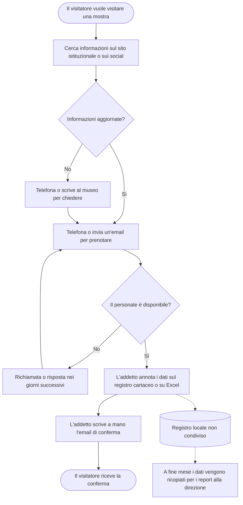
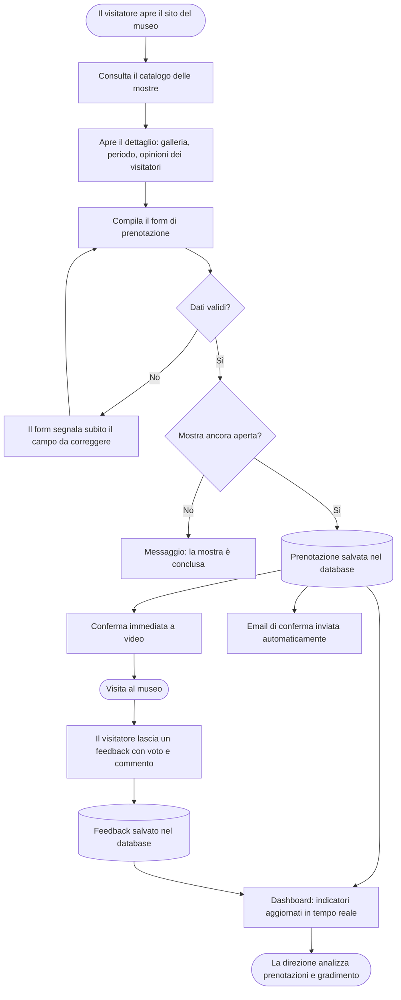
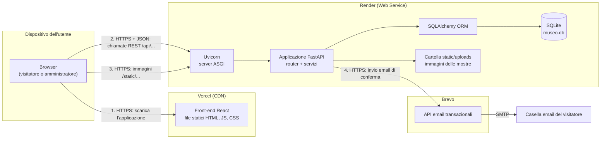
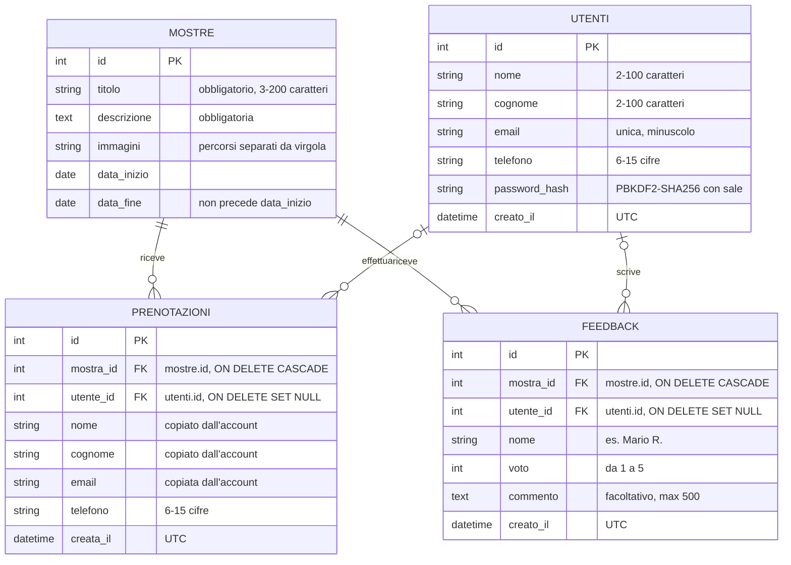
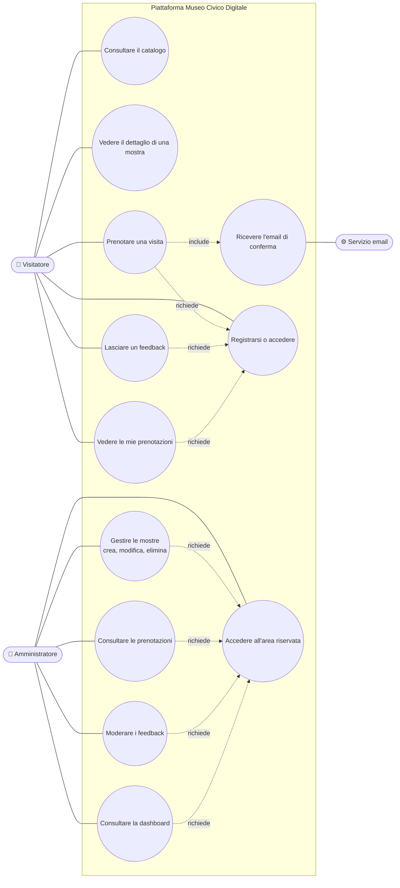
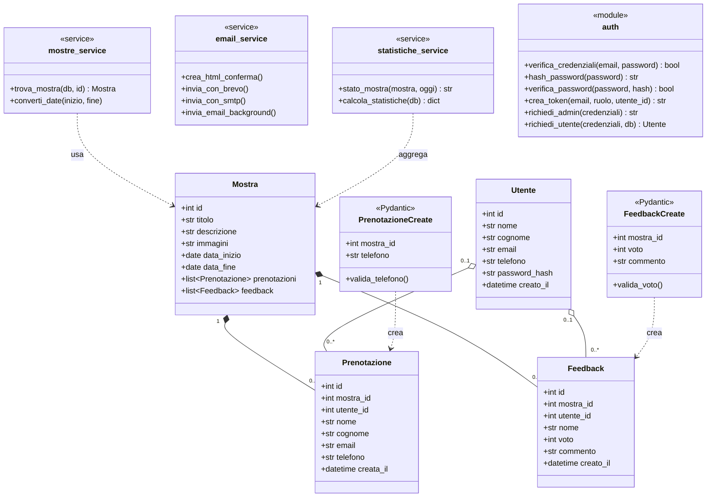
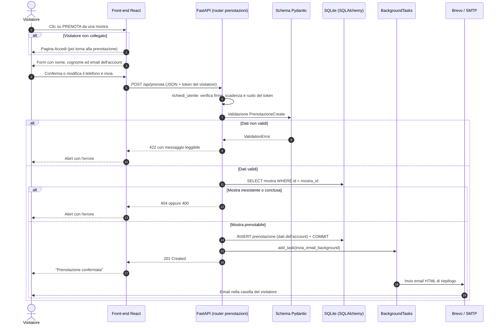
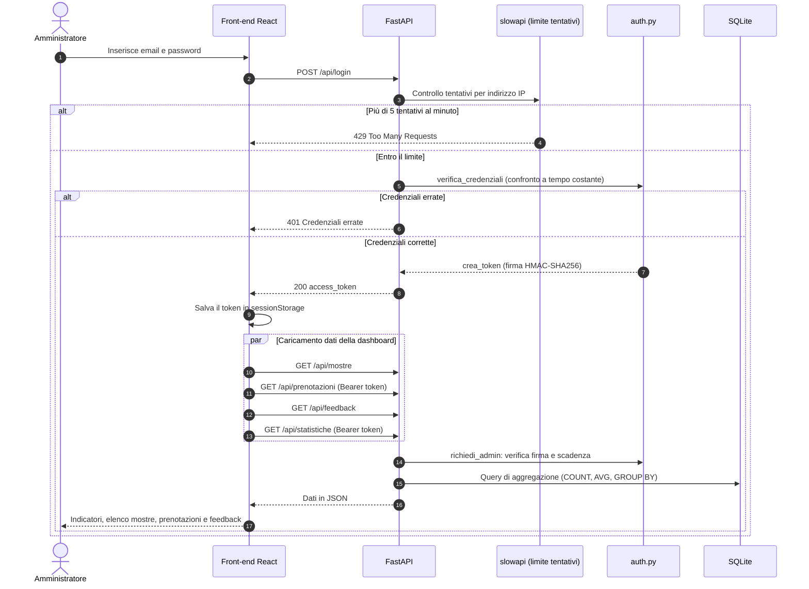

# RELAZIONE TECNICA DI PROGETTO
## Project Work - MUSEO DIGITALE
## Tema n. 1: La digitalizzazione dell’impresa
### PW 2 Digitalizzazione dei processi aziendali in un’impresa culturale:
Progettazione di una piattaforma informatica per la gestione di servizi, dati e utenti

**Autrice:** Roberta Randazzo
**Repository:** [github.com/reverserob/museo-digitale-pw](https://github.com/reverserob/museo-digitale-pw)
**Applicazione online:** [museo-digitale-pw-azure.vercel.app](https://museo-digitale-pw-azure.vercel.app/)

#### Indice
1. [Contesto organizzativo](#1-contesto-organizzativo)
2. [Problema e analisi del processo](#2-problema-e-analisi-del-processo)
3. [Requisiti e soluzione proposta](#3-requisiti-e-soluzione-proposta)
4. [Architettura del sistema](#4-architettura-del-sistema)
5. [Modello dei dati](#5-modello-dei-dati)
6. [Diagrammi UML](#6-diagrammi-uml)
7. [Documentazione delle API](#7-documentazione-delle-api)
8. [Architettura dei calcolatori applicata al progetto](#8-architettura-dei-calcolatori-applicata-al-progetto)
9. [Scelte tecnologiche e sicurezza](#9-scelte-tecnologiche-e-sicurezza)
10. [Implementazione del front-end](#10-implementazione-del-front-end)
11. [Qualità del codice e test automatici](#11-qualità-del-codice-e-test-automatici)
12. [Test funzionali e scenari d'uso](#12-test-funzionali-e-scenari-duso)
13. [Istruzioni per l'esecuzione](#13-istruzioni-per-lesecuzione)
14. [Deploy](#14-deploy)
15. [Limiti e sviluppi futuri](#15-limiti-e-sviluppi-futuri)
16. [Dichiarazione sull'uso di strumenti di intelligenza artificiale](#16-dichiarazione-sulluso-di-strumenti-di-intelligenza-artificiale)

---

### 1. Contesto organizzativo
Il progetto è ambientato in un **museo civico di medie dimensioni** (organizzazione simulata), di proprietà comunale, che affianca alla collezione permanente un programma di **mostre temporanee**: tre o quattro esposizioni all'anno, ciascuna della durata di alcuni mesi.

Lo scenario ipotizzato è il seguente:

| Aspetto | Situazione ipotizzata |
|---|---|
| Natura giuridica | Museo civico, gestito dal Comune |
| Visitatori | circa 25.000 all'anno, con picchi nei fine settimana e durante le inaugurazioni |
| Offerta | collezione permanente + 3-4 mostre temporanee all'anno, visite su prenotazione |
| Personale | direttore, curatore delle mostre, 2 addetti all'accoglienza e alla biglietteria, 1 addetto alla segreteria e alla comunicazione |
| Dotazione informatica | PC d'ufficio, casella email istituzionale, fogli di calcolo; nessun gestionale dedicato alle prenotazioni |
| Canali verso il pubblico | sito istituzionale statico, telefono, email, profili social |

In questo contesto il personale è ridotto e le stesse persone si occupano sia dell'accoglienza sia delle attività amministrative: ogni ora dedicata a operazioni ripetitive (rispondere al telefono, ricopiare prenotazioni, aggiornare il sito) è tolta alla cura dei visitatori e delle mostre.

### 2. Problema e analisi del processo
Il processo scelto per la digitalizzazione è la **gestione delle mostre temporanee e delle prenotazioni delle visite**, che coinvolge tre attori: il visitatore, il personale di accoglienza e la direzione/curatela.

#### 2.1. Processo attuale (AS-IS)
Oggi la prenotazione avviene per telefono o per email. L'addetto controlla la disponibilità su un registro (cartaceo o foglio di calcolo), annota i dati del visitatore e risponde con un'email scritta a mano. Il catalogo delle mostre è pubblicato sul sito istituzionale, aggiornato su richiesta da un fornitore esterno.



**Criticità emerse:**
- **Tempo del personale**: telefonate ed email occupano gli addetti negli stessi orari in cui accolgono il pubblico.
- **Servizio limitato agli orari d'ufficio**: fuori orario non è possibile prenotare.
- **Errori di trascrizione**: nomi, email e numeri di telefono vengono ricopiati più volte (telefono → registro → email → report).
- **Dati frammentati**: il registro non è condiviso; la direzione non sa in tempo reale quante prenotazioni ha ogni mostra.
- **Nessun riscontro dal pubblico**: le opinioni dei visitatori non vengono raccolte in modo strutturato.
- **Catalogo poco aggiornato**: pubblicare o modificare una mostra richiede l'intervento di un fornitore esterno.

#### 2.2. Processo digitalizzato (TO-BE)
Con la piattaforma il visitatore consulta il catalogo e prenota da solo, a qualsiasi ora. La prenotazione viene validata e salvata nel database e la conferma parte automaticamente via email. Il personale gestisce le mostre in autonomia dall'area riservata e la direzione consulta gli indicatori aggiornati in tempo reale.



#### 2.3. Benefici attesi

| Criticità AS-IS | Soluzione TO-BE |
|---|---|
| Prenotazioni solo in orario d'ufficio | Prenotazione online disponibile 24 ore su 24 |
| Dati ricopiati più volte | I dati sono inseriti una sola volta dal visitatore e validati automaticamente |
| Email di conferma scritte a mano | Email generata e inviata dal sistema |
| Registro locale non condiviso | Database unico consultabile dall'area riservata |
| Nessun dato per le decisioni | Dashboard con prenotazioni per mostra, andamento e voto medio |
| Nessun riscontro dal pubblico | Feedback con voto da 1 a 5 e commento, moderabili dall'amministratore |
| Catalogo aggiornato da un fornitore esterno | Il personale pubblica e modifica le mostre in autonomia |

### 3. Requisiti e soluzione proposta
Il presente Project Work ha come obiettivo la progettazione e lo sviluppo di una piattaforma informatica full-stack orientata alla digitalizzazione dei processi del museo.

#### 3.1. Requisiti funzionali
- **RF1 – Catalogo**: il visitatore consulta l'elenco delle mostre e il dettaglio con la galleria di immagini.
- **RF2 – Prenotazione**: il visitatore registrato prenota una visita; nome, cognome ed email arrivano dal suo account e può indicare un telefono diverso. Non è possibile prenotare una mostra già conclusa.
- **RF3 – Conferma**: dopo la prenotazione il visitatore riceve un'email di riepilogo.
- **RF4 – Feedback**: il visitatore registrato lascia un voto da 1 a 5 e un commento facoltativo su una mostra già iniziata (uno per mostra); i feedback sono visibili a tutti, anche senza account, con nome e iniziale del cognome.
- **RF5 – Accesso riservato**: l'amministratore accede con email e password.
- **RF10 – Account dei visitatori**: chiunque può consultare il catalogo, ma per prenotare e lasciare feedback deve registrarsi (nome, cognome, email, telefono, password) o accedere. Nell'area personale il visitatore vede le proprie prenotazioni.
- **RF6 – Gestione catalogo**: l'amministratore pubblica, modifica ed elimina le mostre e ne carica le immagini.
- **RF7 – Consultazione prenotazioni**: l'amministratore vede le prenotazioni ricevute, suddivise per mostra.
- **RF8 – Moderazione**: l'amministratore può eliminare i feedback non appropriati.
- **RF9 – Dashboard**: l'amministratore consulta indicatori di sintesi (prenotazioni totali e degli ultimi 7 giorni, mostre in corso, in arrivo e concluse, numero di feedback e voto medio, prenotazioni per mostra).

#### 3.2. Requisiti non funzionali
- **Sicurezza**: credenziali fuori dal codice, password dei visitatori salvate solo come hash, token firmati con ruolo (amministratore o visitatore), limite ai tentativi di accesso, validazione di tutti i dati in ingresso, controllo dei file caricati.
- **Usabilità**: interfaccia responsive, messaggi di errore comprensibili, validazione dei form in tempo reale.
- **Manutenibilità**: codice suddiviso per responsabilità, configurazione tramite variabili d'ambiente, test automatici e integrazione continua.
- **Portabilità**: il database si può cambiare (SQLite → PostgreSQL) modificando solo la variabile `DATABASE_URL`.

#### 3.3. La soluzione
Per soddisfare i requisiti di scalabilità, manutenibilità e separazione delle responsabilità, si è optato per un’architettura disaccoppiata (Client-Server):

**Back-end**: sviluppato in Python mediante il framework FastAPI, ad alte prestazioni e basato su Type Hints nativi. Gestisce la logica di business, l'interazione con il database relazionale e i servizi di comunicazione asincrona.

**Front-end**: sviluppato in React (con Vite come bundler) e la libreria di componenti grafici Material-UI (MUI). Offre un'interfaccia utente reattiva, fluida e accessibile, comunicando con il back-end esclusivamente tramite chiamate asincrone basate su API REST (axios).

Questa separazione garantisce che il client e il server possano evolvere indipendentemente, riducendo l'accoppiamento strutturale e migliorando la sicurezza complessiva del sistema.

### 4. Architettura del sistema

#### 4.1. Architettura generale e deploy
Il sistema è composto da tre livelli (presentazione, logica applicativa, dati) distribuiti su servizi diversi:



1. Il browser scarica da Vercel il front-end, cioè file statici distribuiti tramite una rete di server vicini all'utente (CDN).
2. L'applicazione React, in esecuzione nel browser, chiama le API REST del back-end su Render scambiando dati in formato JSON.
3. Le immagini delle mostre sono servite direttamente dal back-end come file statici.
4. Dopo una prenotazione il back-end invia l'email di conferma tramite l'API HTTPS di Brevo (in locale, in alternativa, tramite SMTP).

#### 4.2. Struttura del back-end e separazione delle responsabilità
All'interno del back-end è stato applicato il principio della separazione delle responsabilità (Separation of Concerns): ogni modulo ha un compito preciso e il file principale si limita a configurare l'applicazione e a unire i moduli. Le rotte sono organizzate con gli `APIRouter` di FastAPI, mentre la logica riutilizzabile è raccolta nella cartella `services/`.

```
backend/
├── main.py                 → crea l'app, configura CORS, file statici e gestori errori, include i router
├── settings.py             → configurazione letta dalle variabili d'ambiente (.env / .env.local)
├── database.py             → connessione SQLAlchemy e dipendenza get_db()
├── models.py               → modelli ORM (Mostra, Prenotazione, Feedback, Utente)
├── schemas.py              → schemi Pydantic per la validazione di input e output
├── auth.py                 → hash delle password, token con ruolo, controlli di accesso (admin e visitatori)
├── routers/
│   ├── login.py            → POST /api/login (amministratore)
│   ├── utenti.py           → registrazione, login, profilo e prenotazioni dei visitatori (/api/utenti)
│   ├── mostre.py           → CRUD delle mostre (/api/mostre)
│   ├── prenotazioni.py     → POST /api/prenota, GET /api/prenotazioni
│   ├── feedback.py         → POST, GET e DELETE /api/feedback
│   └── statistiche.py      → GET /api/statistiche (indicatori della dashboard)
├── services/
│   ├── mostre_service.py   → ricerca di una mostra e controllo delle date (usato da più router)
│   ├── email_service.py    → email di conferma (API Brevo o SMTP)
│   ├── immagini_service.py → validazione e salvataggio delle immagini caricate
│   ├── statistiche_service.py → calcolo degli indicatori per la dashboard
│   ├── rate_limit_service.py → limite ai tentativi di login (slowapi)
│   ├── error_service.py    → formattazione degli errori di validazione (422)
│   ├── migrazioni_service.py → aggiunge al database esistente le colonne introdotte dopo la prima versione
│   └── seed_service.py     → inserimento delle mostre iniziali lette da data/mostre.json
├── data/mostre.json        → dati delle mostre iniziali
├── static/uploads/         → immagini delle mostre
└── tests/                  → test automatici (pytest)
```

I vantaggi di questa organizzazione sono:
- **Leggibilità**: chi cerca le rotte delle mostre apre `routers/mostre.py`, chi deve modificare il testo dell'email apre `services/email_service.py`.
- **Riutilizzo**: i servizi sono funzioni indipendenti dalle rotte; ad esempio `trova_mostra` (in `services/mostre_service.py`) è usata dai router delle mostre, delle prenotazioni e dei feedback, senza che un router dipenda dall'altro.
- **Manutenibilità**: aggiungere una nuova area funzionale significa creare un nuovo router e registrarlo in `main.py` con `app.include_router(...)`, senza toccare il codice esistente. I router `feedback`, `statistiche` e `utenti` sono stati aggiunti proprio in questo modo.
- **Documentazione**: ogni router ha un proprio tag, quindi nella Swagger UI le rotte compaiono raggruppate in *Area riservata*, *Visitatori*, *Mostre*, *Prenotazioni* e *Feedback*.

### 5. Modello dei dati
Il sistema si appoggia a un database relazionale SQLite, interfacciato tramite l'ORM SQLAlchemy per la gestione trasparente delle entità in oggetti Python. Le tabelle vengono create automaticamente all'avvio e, se il database è vuoto, vengono inserite le mostre dimostrative descritte nel file `data/mostre.json` (seeding): per aggiungere o modificare le mostre iniziali basta modificare il file JSON, senza toccare il codice.

Nello stesso file ogni mostra può avere un elenco di `feedback` (nome, voto, commento): 
le recensioni indicate vengono inserite insieme alla mostra e collegate a essa tramite la relazione SQLAlchemy, così l'applicazione parte già con dei dati dimostrativi anche per la sezione delle opinioni e per gli indicatori della dashboard. Nei test automatici questi feedback vengono rimossi prima di ogni test, così i conteggi partono sempre da zero.

#### 5.1. Diagramma Entità-Relazione



#### 5.2. Descrizione delle entità
- **mostre**: memorizza le esposizioni culturali (il catalogo). Le immagini sono salvate su disco e nel database se ne conservano i percorsi relativi (es. `/static/uploads/<file>.webp`).
- **prenotazioni**: memorizza le prenotazioni effettuate dai visitatori, con data e ora di creazione.
- **feedback**: memorizza le recensioni dei visitatori, con voto da 1 a 5 e commento facoltativo.
- **utenti**: memorizza gli account dei visitatori. La password non viene mai salvata: si conserva solo il suo hash PBKDF2-SHA256, calcolato con un sale casuale e 200.000 iterazioni. L'email è unica.

**Relazioni**: una mostra ha zero o più prenotazioni e zero o più feedback (relazioni 1:N); ogni prenotazione e ogni feedback appartengono a una sola mostra. Un utente può avere più prenotazioni e più feedback (al massimo uno per mostra). Nella prenotazione nome, cognome ed email vengono copiati dall'account al momento della prenotazione, così lo storico resta leggibile anche se l'account cambia; `utente_id` è facoltativo perché i feedback dimostrativi del seeding non hanno un autore. Eliminando una mostra vengono eliminati anche le prenotazioni e i feedback collegati (cascade), così nel database non restano righe "orfane".

**Vincoli applicativi**: i dati inseriti dagli utenti vengono validati a livello di schema (Pydantic con espressioni regolari e validatori personalizzati) prima di essere salvati. Non è possibile prenotare una mostra già conclusa, né lasciare un feedback su una mostra non ancora iniziata.

**Aggiornamento dei database esistenti**: `create_all` crea le tabelle nuove ma non aggiunge colonne a quelle già presenti. All'avvio `migrazioni_service.py` controlla lo schema e, se manca, aggiunge la colonna `utente_id` alle tabelle `prenotazioni` e `feedback` con `ALTER TABLE`, così un `museo.db` creato con la versione precedente continua a funzionare senza perdere dati.

**Indicatori**: i dati delle tabelle mostre, prenotazioni e feedback alimentano la dashboard. Il servizio `statistiche_service.py` calcola i conteggi con query di aggregazione (`COUNT` e `AVG` raggruppati per mostra con `GROUP BY`), invece di caricare in memoria tutte le righe.

### 6. Diagrammi UML

#### 6.1. Diagramma dei casi d'uso
Gli attori sono il **visitatore** (che consulta il catalogo senza account e si registra per prenotare e lasciare feedback), l'**amministratore** (personale del museo) e il **servizio email** esterno.



#### 6.2. Diagramma delle classi
Il diagramma mostra le classi del modello dati (SQLAlchemy), gli schemi di validazione principali (Pydantic) e i moduli di servizio usati dai router. Le frecce tratteggiate indicano una dipendenza: ad esempio uno schema `PrenotazioneCreate` validato viene usato per creare un oggetto `Prenotazione`; `statistiche_service` aggrega i dati di mostre, prenotazioni e feedback.



Le linee con il rombo vuoto indicano un'**aggregazione** tra `Utente` e prenotazioni o feedback: se l'account viene eliminato, prenotazioni e feedback restano (con `utente_id` vuoto). Le linee con il rombo pieno indicano una **composizione** tra `Mostra` e le altre due classi (1 a 0..*): prenotazioni e feedback non esistono senza la mostra a cui si riferiscono, e infatti vengono eliminati insieme a essa.

#### 6.3. Diagramma di sequenza: prenotazione di una visita
Il diagramma mostra il percorso completo di una prenotazione, dal form fino all'email, evidenziando che l'email viene inviata **dopo** la risposta al browser.



#### 6.4. Diagramma di sequenza: accesso all'area riservata e dashboard



### 7. Documentazione delle API
FastAPI genera in modo automatico e nativo la documentazione interattiva delle API basata sullo standard OpenAPI. All'indirizzo [http://127.0.0.1:8000/docs](http://127.0.0.1:8000/docs) è possibile esplorare e testare gli endpoint in tempo reale (Swagger UI), raggruppati per router. Lo screenshot della Swagger UI è riportato nel README del progetto.

#### 7.1. Elenco degli endpoint
🔒 = richiede il token dell'amministratore; 👤 = richiede il token di un visitatore registrato. Il token si invia nell'header `Authorization: Bearer <token>`; un token del ruolo sbagliato viene rifiutato (401 o 403).

| Router | Metodo e percorso | Descrizione | Risposte principali |
|---|---|---|---|
| Area riservata | POST /api/login | Verifica le credenziali dell'amministratore e restituisce un token di accesso firmato a tempo. | 200, 401, 429 |
| Visitatori | POST /api/utenti/registrazione | Crea l'account del visitatore (password salvata come hash) e restituisce subito il token e il profilo. | 201, 409, 422, 429 |
| Visitatori | POST /api/utenti/login | Verifica email e password del visitatore e restituisce token e profilo. | 200, 401, 429 |
| Visitatori | 👤 GET /api/utenti/me | Profilo del visitatore collegato. | 200, 401, 403 |
| Visitatori | 👤 GET /api/utenti/me/prenotazioni | Prenotazioni del visitatore collegato, con titolo e periodo della mostra. | 200, 401, 403 |
| Area riservata | 🔒 GET /api/statistiche | Indicatori per la dashboard: conteggi di mostre, prenotazioni e feedback, voto medio, dettaglio per mostra. | 200, 401 |
| Mostre | GET /api/mostre | Restituisce la lista di tutte le esposizioni, ordinate per data di inizio. | 200 |
| Mostre | GET /api/mostre/{mostra_id} | Recupera i dettagli di una singola mostra. | 200, 404 |
| Mostre | 🔒 POST /api/mostre | Caricamento di una nuova mostra e delle relative immagini (multipart/form-data). | 201, 400, 401, 422 |
| Mostre | 🔒 PUT /api/mostre/{mostra_id} | Aggiornamento di un'esposizione esistente. Il campo `immagini_esistenti` (lista JSON) indica quali immagini attuali tenere; le nuove immagini caricate si aggiungono in coda. Deve restare almeno un'immagine. | 200, 400, 401, 404 |
| Mostre | 🔒 DELETE /api/mostre/{mostra_id} | Eliminazione di un'esposizione, delle sue prenotazioni e dei suoi feedback. | 200, 401, 404 |
| Prenotazioni | 👤 POST /api/prenota | Salva la prenotazione con i dati dell'account e avvia in background l'invio dell'email di conferma. | 201, 400, 401, 403, 404, 422 |
| Prenotazioni | 🔒 GET /api/prenotazioni | Elenco delle prenotazioni, filtrabile per mostra (`?mostra_id=`). | 200, 401 |
| Feedback | 👤 POST /api/feedback | Salva il feedback del visitatore su una mostra già iniziata (uno per mostra). | 201, 400, 401, 403, 404, 409, 422 |
| Feedback | GET /api/feedback | Elenco pubblico dei feedback, filtrabile per mostra (`?mostra_id=`), dal più recente. | 200 |
| Feedback | 🔒 DELETE /api/feedback/{feedback_id} | Eliminazione di un feedback (moderazione). | 200, 401, 404 |

#### 7.2. Esempi di richiesta e risposta

**Prenotazione** – `POST /api/prenota`
```json
// richiesta (con header Authorization: Bearer <token del visitatore>; il telefono è facoltativo)
{ "mostra_id": 1, "telefono": "3331234567" }

// risposta 201 Created
{ "message": "Prenotazione effettuata con successo!", "id": 12 }

// risposta 422 Unprocessable Entity (telefono non valido)
{ "detail": "telefono: Il numero di telefono deve contenere da 6 a 15 cifre." }

// risposta 401 Unauthorized (nessun token)
{ "detail": "Accedi o registrati per continuare." }
```

**Feedback** – `POST /api/feedback`
```json
// richiesta (con il token del visitatore; il commento è facoltativo)
{ "mostra_id": 1, "voto": 5, "commento": "Allestimento bellissimo" }

// risposta 201 Created (il nome pubblico viene dall'account: nome e iniziale del cognome)
{ "id": 4, "mostra_id": 1, "nome": "Giulia V.", "voto": 5, "commento": "Allestimento bellissimo", "creato_il": "2026-10-15T09:12:44" }

// risposta 409 Conflict (secondo feedback sulla stessa mostra)
{ "detail": "Hai già lasciato un feedback su questa mostra." }

// risposta 400 Bad Request (mostra non ancora iniziata)
{ "detail": "La mostra non è ancora iniziata: potrai lasciare un feedback dopo la visita." }
```

**Registrazione di un visitatore** – `POST /api/utenti/registrazione`
```json
// richiesta
{ "nome": "Giulia", "cognome": "Verdi", "email": "giulia.verdi@esempio.it", "telefono": "3471234567", "password": "password-sicura" }

// risposta 201 Created (il visitatore è già collegato)
{ "access_token": "eyJzdWIiOi...", "token_type": "bearer",
  "utente": { "id": 3, "nome": "Giulia", "cognome": "Verdi", "email": "giulia.verdi@esempio.it", "telefono": "3471234567" } }

// risposta 409 Conflict
{ "detail": "Esiste già un account con questa email." }
```

**Statistiche** – `GET /api/statistiche` (🔒)
```json
{
  "totale_mostre": 4,
  "mostre_in_corso": 1,
  "mostre_future": 3,
  "mostre_concluse": 0,
  "totale_prenotazioni": 11,
  "prenotazioni_ultimi_7_giorni": 11,
  "totale_feedback": 5,
  "voto_medio": 4.6,
  "per_mostra": [
    { "mostra_id": 1, "titolo": "Caravaggio e il suo tempo", "stato": "in corso", "prenotazioni": 4, "feedback": 5, "voto_medio": 4.6 }
  ]
}
```

#### 7.3. Codici di stato utilizzati

| Codice | Significato nel progetto |
|---|---|
| 200 OK / 201 Created | Operazione riuscita / risorsa creata |
| 400 Bad Request | Errore di logica: date incoerenti, mostra conclusa o non iniziata, file non valido o troppo grande, mostra senza immagini |
| 401 Unauthorized | Credenziali errate, token assente, manomesso, scaduto o del ruolo sbagliato per l'area riservata |
| 403 Forbidden | Token valido ma del ruolo sbagliato: l'amministratore che prova a prenotare o a lasciare un feedback |
| 404 Not Found | Mostra o feedback inesistente |
| 409 Conflict | Email già registrata, oppure secondo feedback dello stesso visitatore sulla stessa mostra |
| 422 Unprocessable Entity | Dati che non rispettano lo schema (con messaggio leggibile) |
| 429 Too Many Requests | Troppi tentativi di login o di registrazione dallo stesso indirizzo IP |
| 500 Internal Server Error | Errore imprevisto nel salvataggio (la transazione viene annullata con rollback) |

### 8. Architettura dei calcolatori applicata al progetto
Questa sezione collega le scelte del progetto ai concetti di architettura dei calcolatori: come i dati vengono **rappresentati**, **elaborati**, **memorizzati** e **trasmessi** tra i componenti.

#### 8.1. Modello client-server e comunicazione in rete
Il sistema segue il modello **client-server**: il browser (client) invia richieste, il back-end (server) le elabora e risponde. La comunicazione attraversa la pila dei protocolli di rete:

| Livello | Protocollo nel progetto | Ruolo |
|---|---|---|
| Applicazione | HTTP/1.1 con metodi REST (GET, POST, PUT, DELETE) e dati JSON | Definisce il significato della richiesta e della risposta |
| Sicurezza | TLS (HTTPS) | Cifra i dati in transito, ad esempio password e dati personali |
| Trasporto | TCP | Garantisce che i byte arrivino integri e nell'ordine giusto |
| Rete | IP | Instrada i pacchetti tra il computer dell'utente e i server di Vercel e Render |

Il server è **senza stato** (*stateless*): non conserva sessioni in memoria e ogni richiesta porta con sé tutto ciò che serve, compreso il token di accesso. Questo permetterebbe di avviare più copie del server senza modificare il codice.

Anche il dialogo tra componenti interni segue lo stesso modello: il back-end è a sua volta *client* del servizio Brevo, a cui invia una richiesta HTTPS sulla porta 443. Il protocollo SMTP (porte 25, 465, 587) resta disponibile come alternativa in locale, perché il piano gratuito di Render blocca quelle porte in uscita.

#### 8.2. Processi, thread ed elaborazione asincrona
Il server Uvicorn è un **processo** del sistema operativo che esegue un **ciclo di eventi** (*event loop*): un unico flusso di esecuzione che, mentre una richiesta attende un'operazione di input/output (disco o rete), passa a servirne un'altra invece di restare fermo.

- Le funzioni dichiarate `async def` (ad esempio il caricamento delle immagini) vengono eseguite direttamente nel ciclo di eventi.
- Le funzioni normali `def` (ad esempio le query al database) vengono eseguite da FastAPI in un **pool di thread**, così un'operazione bloccante non ferma le altre richieste.
- L'invio dell'email è affidato ai **BackgroundTasks**: viene eseguito dopo che la risposta è già partita verso il browser. L'utente non attende i tempi di rete del servizio di posta (spesso alcuni secondi), e un eventuale errore di invio non annulla la prenotazione, che è già stata salvata.

È un'applicazione concreta della differenza tra la velocità della CPU (operazioni in nanosecondi) e la lentezza dell'I/O (millisecondi o secondi): il sistema è progettato per non sprecare tempo di CPU in attesa dei dispositivi.

#### 8.3. Gerarchia di memoria e memorizzazione persistente
I dati attraversano diversi livelli della gerarchia di memoria:

| Livello | Cosa contiene nel progetto | Caratteristiche |
|---|---|---|
| Memoria RAM del server | Oggetti Python delle richieste in corso, configurazione letta all'avvio | Veloce ma volatile: si perde allo spegnimento |
| Disco del server | File SQLite `museo.db` e immagini in `static/uploads/` | Persistente, più lento della RAM |
| Memoria del browser | `sessionStorage` con il token dell'amministratore | Locale al dispositivo, si svuota alla chiusura della scheda |
| Cache del browser e CDN | File JavaScript, CSS e immagini già scaricati | Evita di trasferire di nuovo dati invariati |

SQLite memorizza l'intero database in un **unico file** su disco. Ogni prenotazione viene salvata all'interno di una **transazione** (`commit`): o l'operazione viene scritta completamente o, in caso di errore, viene annullata (`rollback`), così il file non resta in uno stato incoerente. Gli **indici** sulle chiavi esterne (`mostra_id`) permettono di trovare le prenotazioni di una mostra senza leggere tutta la tabella.

#### 8.4. Rappresentazione e codifica dei dati
Gli stessi dati cambiano rappresentazione mentre passano da un componente all'altro:

- **Testo**: tutti i messaggi usano la codifica **UTF-8**, che rappresenta anche le lettere accentate e i simboli (es. "è", "★") con sequenze da 1 a 4 byte.
- **JSON**: formato testuale con cui front-end e back-end si scambiano oggetti. Pydantic converte il JSON in oggetti Python tipizzati (es. stringa `"2026-10-10"` → oggetto `date`) e viceversa.
- **Date**: nel database le date sono di tipo `DATE` e gli orari di creazione sono salvati in UTC, il riferimento orario universale; il front-end li converte nel fuso orario dell'utente.
- **Token di accesso**: è composto da due parti codificate in **Base64 URL-safe** e separate da un punto. La prima contiene i dati in JSON (`{"sub": "admin@museo.it", "ruolo": "admin", "exp": 1792083836}`, dove `ruolo` distingue l'amministratore dai visitatori, che hanno anche il proprio identificativo `uid`, dove `exp` è la scadenza espressa in secondi dal 1° gennaio 1970). La seconda è la **firma HMAC-SHA256**: un'impronta di 256 bit calcolata con la chiave segreta del server. Modificando anche un solo bit del contenuto la firma non corrisponde più e il server rifiuta il token. Base64 è una *codifica*, non una cifratura: il contenuto è leggibile, ma non falsificabile.
- **Password**: le password dei visitatori non vengono memorizzate. Si salva una stringa con algoritmo, numero di iterazioni, **sale** (16 byte casuali) e **hash** PBKDF2-HMAC-SHA256, entrambi in Base64. Ripetere l'hash 200.000 volte rende lento indovinare le password per tentativi, e il sale fa sì che due password uguali producano hash diversi.
- **File**: le immagini viaggiano come dati binari in richieste `multipart/form-data`; il server ne controlla tipo ed estensione e assegna un nome casuale (UUID, identificatore di 128 bit).

#### 8.5. Compressione dei dati
Ridurre i byte da trasferire rende il sito più veloce, soprattutto su rete mobile:
- Le **immagini** sono in formato **WebP**, che usa una compressione più efficiente di JPEG e PNG: l'immagine di sfondo del sito è passata da circa 478 KB in JPEG a circa 123 KB in WebP, con qualità visiva equivalente. Anche le immagini delle mostre e gli screenshot di questa relazione sono in WebP.
- I file **JavaScript** vengono minificati da Vite (spazi e nomi lunghi eliminati) e trasferiti compressi con **gzip**: il pacchetto principale passa da circa 377 KB a circa 126 KB.

#### 8.6. Suddivisione del codice e caricamento su richiesta
Il front-end usa `React.lazy` e `Suspense`: Vite divide l'applicazione in più file (*code splitting*) e il browser scarica il codice di una pagina solo quando l'utente la apre. Chi visita solo il catalogo non scarica mai il codice dell'area riservata (`AdminDashboard`, `AdminForm`). È lo stesso principio della **memoria virtuale** e della paginazione su richiesta: si carica in memoria solo ciò che serve, nel momento in cui serve.

### 9. Scelte tecnologiche e sicurezza
#### 9.1. Scelta di FastAPI e performance
FastAPI è stato preferito a framework tradizionali (come Django o Flask) per la sua estrema velocità, paragonabile a NodeJS e Go, grazie alla gestione asincrona nativa (async/await) e alla validazione automatica dei dati gestita da Pydantic. Il sistema di dipendenze (`Depends`) permette inoltre di riutilizzare in modo pulito la sessione del database (`get_db`) e il controllo di autenticazione (`richiedi_admin`) in tutte le rotte.

#### 9.2. Gestione del CORS (Cross-Origin Resource Sharing)
Poiché il client React gira su un'origine diversa dal server FastAPI (porta 5173 contro 8000 in sviluppo, Vercel contro Render in produzione), è stato configurato un middleware CORS (CORSMiddleware). Le origini autorizzate non sono "aperte a tutti" ma elencate esplicitamente nella variabile d'ambiente CORS_ORIGINS.

#### 9.3. Invio asincrono delle email tramite BackgroundTasks
Per evitare che l'invio delle email di conferma blocchi la risposta HTTP, l'applicazione sfrutta i BackgroundTasks di FastAPI. La funzione `invia_email_background`, contenuta in `services/email_service.py`, viene registrata dal router delle prenotazioni con `background_tasks.add_task(...)`: la risposta di successo viene restituita immediatamente al client React e l'email viene inviata subito dopo. Se il servizio email non è configurato, la prenotazione viene comunque salvata e l'evento viene registrato nei log.

L'invio avviene in due modi alternativi.
In locale si può usare il protocollo SMTP (ad esempio con un account Gmail e una "password per le app").
In produzione, invece, il piano gratuito di Render blocca le connessioni in uscita verso le porte SMTP (25, 465, 587): per questo, quando è impostata la variabile `BREVO_API_KEY`, l'email viene inviata tramite l'API del servizio di email transazionale Brevo, che usa una normale richiesta HTTPS (porta 443).

#### 9.4. Sicurezza e variabili sensibili
Le credenziali del servizio email, quelle dell'amministratore e la chiave di firma dei token non sono scritte nel codice: vengono lette da variabili d'ambiente tramite il modulo `settings.py`. In locale i valori si trovano nei file `.env` o `.env.local`, esclusi dal versionamento tramite `.gitignore`; in produzione si impostano dal pannello Environment di Render. Il file `.env.example` documenta le variabili necessarie senza contenere valori reali.

Una variabile assente o lasciata vuota assume un valore di default pensato solo per lo sviluppo locale; all'avvio il server segnala nei log se sono in uso la chiave o la password dimostrative, in modo che vengano sostituite prima della messa online.

#### 9.5. Autenticazione: area riservata e account dei visitatori
Il controllo delle credenziali avviene sul server e non nel browser. L'endpoint POST /api/login confronta le credenziali con quelle configurate (con confronto a tempo costante, per evitare attacchi basati sui tempi di risposta) e restituisce un token che contiene la scadenza ed è firmato con HMAC-SHA256 tramite la SECRET_KEY. Il token non è cifrato ma firmato: il server può leggerne il contenuto e verificare che non sia stato alterato. Il client invia il token nell'header `Authorization: Bearer`; le rotte riservate usano la dipendenza FastAPI `richiedi_admin` (modulo `auth.py`), che rifiuta con 401 Unauthorized le richieste senza un token valido o scaduto.

**Account dei visitatori.** Chiunque può consultare mostre e feedback, ma per prenotare o recensire serve un account. Con `POST /api/utenti/registrazione` il visitatore indica nome, cognome, email, telefono e una password di almeno 8 caratteri; la password viene trasformata in un hash PBKDF2-HMAC-SHA256 con sale casuale e 200.000 iterazioni (funzioni `hash_password` e `verifica_password` in `auth.py`, solo libreria standard di Python) e non viene mai salvata in chiaro. Login e registrazione restituiscono un token firmato con lo stesso meccanismo dell'amministratore, ma con `"ruolo": "utente"` e l'identificativo dell'account. Le rotte di prenotazione e feedback usano la dipendenza `richiedi_utente`, che verifica firma, scadenza e ruolo e carica l'account dal database; `richiedi_admin` accetta invece solo il ruolo `admin`, quindi un visitatore non può entrare nell'area riservata e l'amministratore non può prenotare. In caso di login errato il messaggio è lo stesso sia per email inesistente sia per password sbagliata, così non si rivela quali email sono registrate.

#### 9.6. Gestione sicura del caricamento file
Il caricamento delle immagini è gestito da `services/immagini_service.py`. Le immagini vengono accettate solo se hanno un'estensione e un tipo MIME da immagine (jpg, png, webp, gif) e non superano la dimensione massima configurata. Il nome del file su disco viene generato dal server (UUID), evitando sia la sovrascrittura di file esistenti sia attacchi di tipo path traversal. In modifica il client invia l'elenco delle immagini attuali da mantenere: il server accetta solo percorsi già associati a quella mostra, così dal form non è possibile collegare file arbitrari. Nel database si salvano percorsi relativi: è il frontend ad anteporre l'indirizzo del backend, così l'applicazione funziona sia in locale sia in produzione. I dati inseriti dagli utenti vengono inoltre "escapati" prima di essere inseriti nel corpo HTML dell'email di conferma.

#### 9.7. Limite ai tentativi di accesso
Per impedire attacchi "a forza bruta" (provare molte password in sequenza), gli endpoint di login (amministratore e visitatori) e di registrazione sono protetti dalla libreria `slowapi`: ogni indirizzo IP può effettuare un numero limitato di tentativi (di default 5 al minuto, configurabile con la variabile `LOGIN_RATE_LIMIT`). Superato il limite il server risponde 429 Too Many Requests con un messaggio leggibile, che il frontend mostra nel form di accesso. Poiché in produzione il backend si trova dietro il proxy di Render, uvicorn viene avviato con l'opzione `--proxy-headers`, così da leggere l'indirizzo IP reale del visitatore.

#### 9.8. Feedback dei visitatori
I feedback si leggono senza account, ma per scriverne uno serve il login: così ogni recensione è legata a una persona registrata e si riducono spam e recensioni multiple. Il server accetta solo voti interi da 1 a 5, commenti di lunghezza limitata, feedback su mostre già iniziate e al massimo un feedback per visitatore su ogni mostra (409 al secondo tentativo). Nel feedback pubblico compaiono solo il nome e l'iniziale del cognome (es. "Giulia V."), mai email o telefono, secondo il principio di minimizzazione dei dati personali. L'amministratore può eliminare i contenuti non appropriati.

### 10. Implementazione del front-end
#### 10.1. Architettura dei componenti e Single Page Application (SPA)
Il front-end è stato sviluppato come una Single Page Application (SPA) modulare basata su React e React Router. Il codice è organizzato per responsabilità:

```
frontend/src/
├── App.jsx        → tema, router e rotte
├── config/        → routes.json (elenco delle rotte) e background.json (immagine di sfondo)
├── pages/         → una pagina per rotta: Home, GalleriaMostra, FormPrenotazione, Accedi, AreaPersonale, AdminDashboard, AdminForm, NotFound
├── components/    → componenti riutilizzabili: AppHeader, ProtectedRoute, ErrorBoundary, SezioneFeedback, IndicatoriDashboard
├── hooks/         → useUtente: il visitatore collegato, aggiornato a ogni login e logout
├── services/      → api.js (istanza Axios) e un servizio per area: mostre, prenotazioni, feedback, statistiche, auth (admin), utenti (visitatori)
├── styles/        → fogli di stile del layout
└── tests/         → test automatici (Vitest)
```

Le rotte non sono scritte nel codice ma lette da `config/routes.json`: ogni rotta indica il percorso e il nome della pagina da mostrare. Le rotte riservate all'amministratore sono contrassegnate con `"protected": true` e vengono racchiuse nel componente `ProtectedRoute`, che rimanda alla pagina di accesso chi non ha effettuato il login. Un indirizzo inesistente mostra la pagina `NotFound` (errore 404), collegata alla rotta jolly `*`. Le pagine dei visitatori (prenotazione e area personale) sono contrassegnate con `"protected": "utente"`: chi non ha fatto il login viene mandato alla pagina **Accedi** e, dopo l'accesso o la registrazione, torna automaticamente alla pagina che voleva aprire (parametro `?next=`, accettato solo se punta a un indirizzo interno al sito).

Per alleggerire il primo caricamento, le pagine diverse dalla Home vengono caricate solo quando servono (`React.lazy` e `Suspense`): il browser scarica il codice dell'area riservata solo se l'utente la apre.

Per la progettazione dell'interfaccia grafica è stata adottata la libreria Material-UI (MUI), personalizzando i componenti tramite la prop `sx` e un tema grafico coerente con l'identità visiva dell'istituzione culturale (palette cromatica basata su toni scuri e dettagli color oro). Il layout utilizza il componente `Grid` con dimensioni responsive, così da adattarsi anche ai dispositivi mobili.

Le pagine non contengono gli indirizzi delle API: usano le funzioni dei servizi (ad esempio `getMostre()`, `prenota(dati)`, `inviaFeedback(dati)`, `getStatistiche()`), così ogni indirizzo è definito in un solo punto, in modo analogo ai servizi del backend. I servizi si appoggiano a un client Axios centralizzato (`services/api.js`), che:
- determina l'indirizzo del backend (variabile `VITE_API_URL`, oppure backend locale in sviluppo e Render in produzione);
- aggiunge automaticamente il token giusto a ogni richiesta: quello del visitatore per prenotazioni, invio di feedback e area personale, quello dell'amministratore per le altre rotte riservate; se un token è scaduto lo cancella (e, per l'admin, riporta alla pagina di login);
- costruisce l'indirizzo completo delle immagini a partire dai percorsi relativi salvati nel database.

Gli stati locali dei componenti (useState, useEffect) garantiscono feedback visivi immediati all'utente, ad esempio gli indicatori di caricamento tramite CircularProgress.

#### 10.2. Feedback e dashboard con indicatori
- **SezioneFeedback** (pagina di dettaglio della mostra): mostra il voto medio con le stelle (componente `Rating` di MUI), l'elenco delle recensioni e il form per lasciarne una nuova. Dopo l'invio la recensione compare subito in cima alla lista, senza ricaricare la pagina. Per le mostre non ancora iniziate il form è sostituito da un messaggio informativo. Se la pagina è aperta dall'amministratore collegato (pulsante **Vedi** della dashboard), compaiono anche una barra con i comandi **Modifica** ed **Elimina** della mostra e un pulsante **Elimina** accanto a ogni feedback, mentre il form per lasciare un feedback è nascosto (l'amministratore legge e modera, ma non recensisce); i visitatori non vedono questi comandi e, in ogni caso, il server accetta le operazioni solo con un token valido.
- **Accedi e AreaPersonale**: la pagina Accedi ha due schede, *Accedi* e *Registrati*, con validazione in tempo reale (il pulsante si attiva solo con dati validi). La sessione del visitatore è salvata nel browser (`localStorage`), quindi resta attiva anche chiudendo la scheda; l'header mostra "Accedi" oppure "Ciao, <nome>" con il link all'area personale, dove il visitatore vede le proprie prenotazioni ed esce. Nel form di prenotazione nome, cognome ed email sono quelli dell'account (sola lettura) e resta modificabile solo il telefono; nella sezione dei feedback chi non è collegato vede l'invito ad accedere al posto del form.
- **IndicatoriDashboard** (area riservata): quattro riquadri con prenotazioni totali (e degli ultimi 7 giorni), mostre in corso (con quelle in arrivo e concluse), numero di feedback e voto medio, seguiti da un grafico a barre orizzontali delle prenotazioni per mostra. Il grafico è realizzato con semplici elementi grafici proporzionati al valore massimo, senza librerie aggiuntive. Sotto ogni mostra l'amministratore può aprire l'elenco delle prenotazioni o dei feedback ed eliminare questi ultimi.

I calcoli degli indicatori sono svolti dal back-end: il front-end riceve numeri già pronti e si limita a mostrarli. In questo modo i dati sono sempre coerenti con il database e la logica è verificabile con i test del server.

#### 10.3. Strategia di validazione end-to-end (client-server)
Per garantire la massima integrità dei dati e prevenire l'invio di informazioni errate o malevole, il sistema adotta una strategia di validazione a doppio livello.

**Validazione lato client (feedback in tempo reale)**

Nel form di prenotazione e gestione, i campi di input sono associati a espressioni regolari (RegEx) e controlli di lunghezza logici in tempo reale:
- Nome e Cognome: richiedono una lunghezza minima di 3 caratteri (.length >= 3) per evitare stringhe vuote o frammentarie.
- Telefono: viene filtrato tramite RegEx (/^\d{6,15}$/) per accettare esclusivamente da 6 a 15 cifre numeriche.
- Date della mostra: la data di fine non può precedere quella di inizio.
- Email: viene verificata attraverso un pattern formale di validazione sintattica.
- Feedback: il voto è obbligatorio, nome e commento hanno una lunghezza massima.

Il pulsante di invio della form (PRENOTA / PUBBLICA MOSTRA) rimane disattivato (disabled) fino a quando tutte le condizioni di validità non risultano pienamente soddisfatte, guidando l'utente verso la corretta compilazione.

**Validazione lato server (Pydantic e FastAPI)**

Indipendentemente dai controlli effettuati nel browser, il payload ricevuto viene intercettato da schemi di validazione Pydantic (BaseModel e @field_validator). L'utilizzo del tipo nativo EmailStr e di validatori custom garantisce che nessun dato anomalo o non conforme possa violare i vincoli del database SQLite. In caso di errore di validazione il server risponde con 422 Unprocessable Entity e un messaggio leggibile: il gestore `errore_validazione` (`services/error_service.py`), registrato in `main.py` con `app.add_exception_handler`, trasforma l'elenco di errori di Pydantic in un testo mostrabile direttamente all'utente. Gli errori di logica applicativa, come date incoerenti o file non validi, restituiscono 400 Bad Request.

#### 10.4. Gestione globale degli errori nel client
Al fine di evitare schermate bloccate o silenziose in caso di problemi di rete o disservizi del server, le chiamate asincrone sono protette dal metodo .catch() di Axios, che intercetta i codici di errore HTTP restituiti dal back-end (401, 404, 422, 429, 500). È stato implementato un sistema di notifica basato sul componente Alert di Material-UI: in caso di errori di connessione o fallimenti nelle operazioni di scrittura, un messaggio descrittivo compare in modo dinamico all'utente, migliorando sensibilmente la resilienza e l'usabilità complessiva dell'applicazione.

Ogni pagina è inoltre racchiusa in un componente `ErrorBoundary`: se durante la visualizzazione si verifica un errore imprevisto (ad esempio dati non coerenti), al posto di una pagina bianca compare un messaggio con il dettaglio dell'errore e il pulsante per tornare alla home.

### 11. Qualità del codice e test automatici
Per mantenere il codice uniforme e individuare gli errori prima della pubblicazione sono stati adottati strumenti di controllo automatico:

| | Back-end | Front-end |
|---|---|---|
| Controllo del codice (linter) | Ruff | ESLint |
| Formattazione | Ruff format | Prettier |
| Test automatici | pytest + TestClient di FastAPI (107 test) | Vitest + React Testing Library (92 test) |

**Test del back-end** (cartella `backend/tests/`): verificano le API in modo completo — login corretto ed errato, rifiuto di token assenti, falsi, manomessi o scaduti, limite ai tentativi di accesso, creazione, modifica ed eliminazione delle mostre, controllo degli upload (tipo, dimensione, nomi di file malevoli), modifica delle immagini (mantenute, rimosse, aggiunte), prenotazioni valide e non valide, mostre concluse, invio dell'email di conferma, feedback validi e non validi, moderazione, calcolo degli indicatori della dashboard, registrazione e login dei visitatori, hash delle password, separazione dei ruoli (un visitatore non entra nell'area riservata e l'admin non prenota), un solo feedback per mostra, aggiornamento di un database della versione precedente. I test usano un database temporaneo e sostituiscono l'invio delle email con una funzione simulata, quindi non modificano i dati reali.

**Test del front-end** (cartella `frontend/src/tests/`): montano le pagine in un browser simulato (jsdom) e sostituiscono le risposte del backend con dati finti. Verificano la visualizzazione delle mostre, la validazione dei form, l'invio delle prenotazioni e dei feedback, login e logout dell'area riservata, registrazione e accesso dei visitatori con ritorno alla pagina richiesta, area personale, scelta del token per ogni chiamata, gli indicatori della dashboard, la protezione delle rotte, la pagina 404 e il caricamento delle pagine "lazy".

**Integrazione continua (GitHub Actions)**: il file `.github/workflows/ci.yml` esegue automaticamente, a ogni push e pull request, linter, controllo della formattazione e test di entrambe le parti, oltre alla build di produzione del front-end. Il back-end viene verificato con due versioni di Python. Se un controllo fallisce, GitHub lo segnala accanto al commit, impedendo che un errore passi inosservato.

### 12. Test funzionali e scenari d'uso
I test automatici verificano il codice; i test funzionali verificano invece che l'applicazione, usata da una persona reale, si comporti come previsto. Gli scenari seguenti sono stati eseguiti sull'applicazione avviata in locale (back-end e front-end), con un database popolato con le mostre iniziali e alcune prenotazioni e feedback di prova.

#### 12.1. Riepilogo degli scenari

| ID | Scenario | Attore | Passi | Risultato atteso | Esito |
|---|---|---|---|---|---|
| TF01 | Consultazione del catalogo | Visitatore | Aprire la home page | Le mostre sono elencate con titolo, periodo e descrizione | ✅ Superato |
| TF02 | Dettaglio di una mostra | Visitatore | Clic su "Scopri di più" | Compaiono galleria, periodo espositivo, pulsante "Prenota" e opinioni dei visitatori | ✅ Superato |
| TF03 | Invio di un feedback | Visitatore | Scegliere 5 stelle, scrivere nome e commento, "Invia feedback" | Messaggio di conferma; la recensione compare in cima alla lista e la media si aggiorna | ✅ Superato |
| TF04 | Prenotazione con dati errati | Visitatore | Inserire nome di 2 lettere, email incompleta, telefono con trattino | Ogni campo errato è evidenziato con il motivo; il pulsante "Prenota" resta disattivato | ✅ Superato |
| TF05 | Prenotazione corretta | Visitatore | Correggere i dati e premere "Prenota" | Messaggio "Prenotazione confermata" con l'indirizzo email del visitatore | ✅ Superato |
| TF06 | Ricezione dell'email | Visitatore | Controllare la casella dopo TF05 | Arriva l'email di riepilogo con titolo e periodo della mostra | ✅ Superato |
| TF07 | Indirizzo inesistente | Visitatore | Aprire `/pagina-inesistente` | Viene mostrata la pagina 404 con il collegamento alla home | ✅ Superato |
| TF08 | Login con password errata | Amministratore | Inserire una password sbagliata | Messaggio "Credenziali errate."; l'area riservata non si apre | ✅ Superato |
| TF09 | Dashboard con indicatori | Amministratore | Accedere con le credenziali corrette | Riquadri con prenotazioni, mostre in corso, feedback e voto medio; barre per mostra | ✅ Superato |
| TF10 | Prenotazioni di una mostra | Amministratore | Clic su "Prenotazioni (n)" | Elenco con nome, email, telefono, data e ora di ogni prenotazione | ✅ Superato |
| TF11 | Moderazione dei feedback | Amministratore | Clic su "Feedback (n)" e poi su "Elimina" | Il feedback viene rimosso dopo la conferma | ✅ Superato |
| TF12 | Pubblicazione di una mostra | Amministratore | "Nuova mostra", compilare il form e aggiungere più immagini, anche in momenti diversi | Le immagini si sommano con anteprima; il pulsante si attiva solo con tutti i campi validi; la mostra compare nel catalogo con tutte le foto | ✅ Superato |
| TF12b | Modifica delle immagini di una mostra | Amministratore | "Modifica", togliere una foto con ✕ e aggiungerne una nuova, "Salva modifiche" | Il form mostra le foto attuali; dopo il salvataggio restano quelle non tolte più quella nuova | ✅ Superato |
| TF12c | Mostra vista dall'amministratore | Amministratore | Dalla dashboard premere "Vedi" su una mostra | Compare la barra "Area admin" con Dashboard, Modifica ed Elimina; i feedback si possono leggere ed eliminare ma il form per lasciarne è nascosto | ✅ Superato |
| TF15 | Prenotazione senza account | Visitatore | Premere "Prenota" senza aver fatto il login | Si apre la pagina Accedi; dopo la registrazione si torna al form di prenotazione | ✅ Superato |
| TF16 | Registrazione | Visitatore | Scheda "Registrati": nome, cognome, email, telefono, password di almeno 8 caratteri | Il pulsante si attiva solo con dati validi; l'account viene creato e il visitatore è subito collegato | ✅ Superato |
| TF17 | Prenotazione da visitatore registrato | Visitatore | Aprire il form di prenotazione da collegato | Nome, cognome ed email dell'account non modificabili, telefono proposto; la prenotazione va a buon fine e l'admin la vede con i dati dell'account | ✅ Superato |
| TF18 | Area personale | Visitatore | "Ciao, <nome>" nell'header | Elenco delle proprie prenotazioni con titolo e periodo della mostra; pulsante "Esci" | ✅ Superato |
| TF19 | Feedback senza account | Visitatore | Aprire una mostra in corso senza login | Le recensioni sono visibili; al posto del form c'è l'invito ad accedere | ✅ Superato |
| TF20 | Login visitatore errato | Visitatore | Password sbagliata nella scheda "Accedi" | Messaggio "Email o password errate."; poi con la password giusta si entra nell'area personale | ✅ Superato |
| TF13 | Accesso diretto a una pagina riservata | Visitatore | Aprire `/admin/nuova` senza login | Si viene reindirizzati alla pagina di accesso | ✅ Superato |
| TF14 | Troppi tentativi di accesso | Chiunque | Sbagliare la password più di 5 volte in un minuto | Messaggio "Troppi tentativi di accesso. Riprova tra qualche minuto." | ✅ Superato |

#### 12.2. Evidenze (screenshot)

**TF01 – Consultazione del catalogo**


**TF02 – Dettaglio di una mostra**


**TF03 – Invio di un feedback**: la nuova recensione compare in cima alla lista e la media passa a 4.6.


**TF04 – Prenotazione con dati errati**: i campi non validi sono evidenziati in rosso e il pulsante è disattivato.


**TF05 – Prenotazione corretta**


**TF06 – Email di conferma ricevuta**


**TF07 – Pagina 404**


**TF08 – Login con password errata**


**TF09 – Dashboard con indicatori**


**TF10 – Prenotazioni di una mostra**


**TF11 – Moderazione dei feedback**


**TF12 – Pubblicazione di una mostra**: le immagini si possono scegliere in più volte; ogni foto ha l'anteprima e il pulsante ✕ per toglierla. Il pulsante "Pubblica mostra" si attiva solo con tutti i campi validi.


**TF12b – Modifica delle immagini di una mostra**: il form mostra le foto già salvate; si possono togliere singolarmente e aggiungerne di nuove.


**TF12c – Mostra vista dall'amministratore**: dalla dashboard, con il pulsante "Vedi", l'amministratore apre la pagina pubblica della mostra con in più la barra di gestione.


Nella sezione delle opinioni l'amministratore legge i feedback e può eliminarli, ma non può lasciarne di nuovi.


**TF16 – Registrazione di un visitatore**


**TF17 – Prenotazione da visitatore registrato**: nome, cognome ed email arrivano dall'account; l'header mostra "Ciao, Giulia".


**TF18 – Area personale con le proprie prenotazioni**


**TF19 – Feedback senza account**: le recensioni restano visibili, ma per scriverne una bisogna accedere. Il feedback "Giulia V." è stato lasciato da un visitatore registrato.


### 13. Istruzioni per l'esecuzione
#### 13.1. Prerequisiti
- Python 3.9 o successivo
- Node.js 20 o successivo (con npm)
- Git

#### 13.2. Avvio del back-end
```bash
git clone https://github.com/reverserob/museo-digitale-pw.git
cd museo-digitale-pw/backend
python -m venv venv
source venv/bin/activate          # su Windows: venv\Scripts\activate
pip install -r requirements.txt
cp .env.example .env              # poi compilare i valori necessari
uvicorn main:app --reload
```
Il back-end è disponibile su `http://127.0.0.1:8000` e la documentazione delle API su `http://127.0.0.1:8000/docs`. Al primo avvio viene creato il file `museo.db` con le mostre iniziali.

#### 13.3. Avvio del front-end
In un secondo terminale:
```bash
cd museo-digitale-pw/frontend
npm install
npm run dev
```
L'applicazione è disponibile su `http://localhost:5173`. In locale, se `ADMIN_EMAIL` e `ADMIN_PASSWORD` non sono impostate, l'area riservata usa le credenziali dimostrative `admin@museo.it` / `admin2026`. Per provare prenotazioni e feedback basta creare un account visitatore dalla pagina **Accedi → Registrati**.

#### 13.4. Variabili d'ambiente principali

| Variabile | Descrizione |
|---|---|
| `ADMIN_EMAIL` / `ADMIN_PASSWORD` | Credenziali dell'area riservata |
| `SECRET_KEY` | Chiave per firmare i token di accesso (valore casuale lungo) |
| `SMTP_USER` / `SMTP_PASSWORD` | Account e "password per le app" per l'invio delle email via SMTP |
| `BREVO_API_KEY` | Facoltativa: chiave API di Brevo; se presente le email partono via API HTTPS |
| `EMAIL_MITTENTE` / `EMAIL_MITTENTE_NOME` | Mittente delle email inviate con Brevo (indirizzo verificato su Brevo) |
| `CORS_ORIGINS` | Domini del front-end autorizzati, separati da virgola |
| `DATABASE_URL` | Facoltativa, default `sqlite:///./museo.db` |
| `LOGIN_RATE_LIMIT` | Facoltativa, tentativi di login consentiti per IP (default `5/minute`) |
| `VITE_API_URL` | (front-end) indirizzo del back-end, se diverso da quello predefinito |

#### 13.5. Esecuzione dei test e dei controlli
```bash
# back-end
cd backend
pip install -r requirements-dev.txt
pytest                # test automatici
ruff check .          # linter
ruff format --check . # formattazione

# front-end
cd frontend
npm test              # test automatici
npm run lint          # ESLint
npm run build         # build di produzione
```

### 14. Deploy
L'applicazione è pubblicata con due servizi separati, coerentemente con l'architettura disaccoppiata:
- **Front-end** su Vercel: [museo-digitale-pw-azure.vercel.app](https://museo-digitale-pw-azure.vercel.app/)
- **Back-end** su Render: `museo-digitale-pw.onrender.com`

Su Render le variabili d'ambiente (SECRET_KEY, credenziali dell'amministratore, BREVO_API_KEY ed EMAIL_MITTENTE, CORS_ORIGINS, PYTHON_VERSION) sono impostate dal pannello Environment del servizio. Il backend viene avviato con il comando `uvicorn main:app --host 0.0.0.0 --port $PORT --proxy-headers --forwarded-allow-ips '*'`, che permette al server di conoscere l'indirizzo IP reale dei visitatori (necessario per il limite ai tentativi di login). Le versioni delle librerie Python sono fissate in `requirements.txt`, così il server installa sempre le stesse versioni verificate in locale.

### 15. Limiti e sviluppi futuri
#### 15.1. Limiti della soluzione attuale
La piattaforma è un prototipo funzionante; alcune semplificazioni sono accettabili in questa fase ma andrebbero superate in un uso reale:
- **Persistenza su Render free**: sul piano gratuito il disco non è persistente; a ogni riavvio il database SQLite e le immagini caricate dall'area riservata vengono azzerati. Le mostre iniziali vengono ricreate automaticamente dal seeding.
- **Un solo amministratore**: le credenziali sono configurate tramite variabili d'ambiente; non esistono più account né ruoli diversi (es. curatore e biglietteria).
- **Nessuna gestione dei posti**: la prenotazione non prevede fasce orarie né un numero massimo di visitatori per giorno.
- **Feedback non legati alla visita**: per recensire serve un account, ma non si verifica che il visitatore abbia davvero visitato la mostra; la moderazione è manuale.
- **Account semplici**: l'email del visitatore non viene verificata con un link di conferma e non c'è ancora il recupero della password dimenticata.
- **Avvio lento del back-end**: sul piano gratuito il servizio va in pausa dopo un periodo di inattività e la prima richiesta può richiedere alcune decine di secondi.

#### 15.2. Sviluppi futuri
**Analytics e cruscotto decisionale**
La dashboard attuale mostra indicatori di sintesi. Il passo successivo è l'analisi nel tempo: grafici dell'andamento delle prenotazioni per settimana, tasso di presenza reale rispetto alle prenotazioni (registrando l'ingresso con un QR code inviato nell'email), fasce orarie più richieste, provenienza dei visitatori. Questi dati aiuterebbero la direzione a pianificare il personale e a scegliere le mostre future.

**Intelligenza artificiale**
- *Raccomandazioni*: suggerire al visitatore mostre affini a quelle già prenotate o recensite.
- *Analisi del sentiment*: classificare automaticamente i commenti dei feedback (positivi, negativi, neutri) e segnalare all'amministratore quelli da moderare.
- *Assistente virtuale*: un chatbot che risponde alle domande frequenti (orari, accessibilità, biglietti), riducendo ulteriormente telefonate ed email al personale.
- *Accessibilità*: descrizioni testuali delle opere generate automaticamente e poi riviste dal curatore, utili alle persone non vedenti.

**Servizi cloud**
- Sostituire SQLite con un database gestito (es. PostgreSQL, già supportato tramite la variabile `DATABASE_URL`) con backup automatici.
- Spostare le immagini su uno storage di oggetti (es. Amazon S3 o Cloudinary) servito tramite CDN.
- Passare a un piano con disco persistente e più istanze del back-end, possibile perché il server è senza stato.

**Pagamenti online**
Integrare un servizio di pagamento (es. Stripe o PayPal, oppure pagoPA per un ente pubblico) per acquistare il biglietto al momento della prenotazione, con emissione della ricevuta e biglietto con QR code. Richiederebbe una nuova tabella `pagamenti` collegata alle prenotazioni e la gestione delle notifiche di esito inviate dal fornitore.

**Cybersecurity**
- Verifica dell'email in fase di registrazione e recupero della password tramite link temporaneo.
- Account anche per il personale del museo, nella stessa tabella `utenti`, con ruoli distinti (amministratore, curatore, biglietteria) al posto dell'unico amministratore configurato nelle variabili d'ambiente.
- Autenticazione a due fattori (2FA) per l'area riservata.
- Protezione dei form pubblici dallo spam con CAPTCHA e limiti di frequenza anche su prenotazioni e feedback.
- Conformità al GDPR: informativa privacy e consenso al trattamento nel form, cancellazione automatica delle prenotazioni dopo un periodo definito, possibilità per il visitatore di chiedere la rimozione dei propri dati.
- Registro delle operazioni amministrative (audit log) e monitoraggio degli errori in produzione.

### 16. Dichiarazione sull'uso di strumenti di intelligenza artificiale
Nello sviluppo del progetto è stato utilizzato l'assistente di intelligenza artificiale Claude (Anthropic) come strumento di supporto, in particolare per:
- la revisione del codice e l'individuazione di errori e problemi di sicurezza;
- il supporto alla riorganizzazione del back-end (router e servizi) e del front-end (pagine, componenti e servizi);
- la scrittura di parte dei test automatici e della configurazione dell'integrazione continua;
- l'implementazione delle funzionalità di feedback e della dashboard con indicatori;
- la stesura di parti della documentazione e dei diagrammi.

L'analisi del contesto, le scelte progettuali, la verifica del funzionamento dell'applicazione e la revisione finale del codice e della relazione sono state curate dall'autrice.
