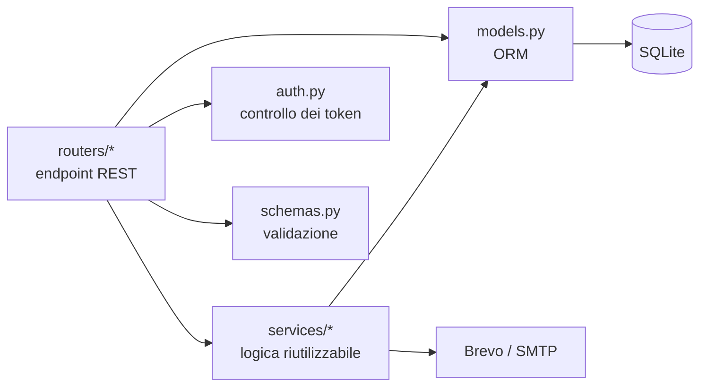

# Backend

Il backend è un'applicazione **FastAPI** organizzata secondo il principio di separazione delle responsabilità:
le rotte stanno nei **router**, la logica riutilizzabile nei **servizi**, i dati nei **modelli** SQLAlchemy
e la validazione negli **schemi** Pydantic.

Le pagine di questa sezione sono generate automaticamente con [mkdocstrings](https://mkdocstrings.github.io/)
a partire dai docstring del codice (stile Google, con le sezioni *Args*, *Returns* e *Raises*).
Per ogni funzione è possibile aprire il codice sorgente con il pulsante *Source code*.

| Pagina | Moduli | Contenuto |
| --- | --- | --- |
| [Applicazione e configurazione](applicazione.md) | `main`, `settings`, `database` | Creazione dell'app, variabili d'ambiente, connessione al database |
| [Modelli dei dati](modelli.md) | `models` | Tabelle `mostre`, `prenotazioni`, `feedback`, `utenti` |
| [Schemi Pydantic](schemi.md) | `schemas` | Dati in ingresso e in uscita dalle API e loro validazione |
| [Autenticazione](autenticazione.md) | `auth` | Hash delle password, token firmati, controlli di accesso |
| [Router](router.md) | `routers.*` | Gli endpoint REST |
| [Servizi](servizi.md) | `services.*` | Email, immagini, statistiche, rate limit, seed, migrazioni |

