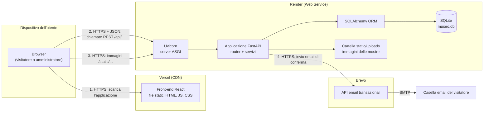
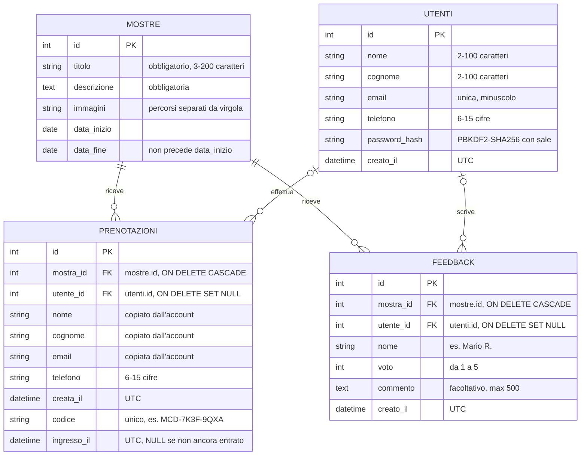
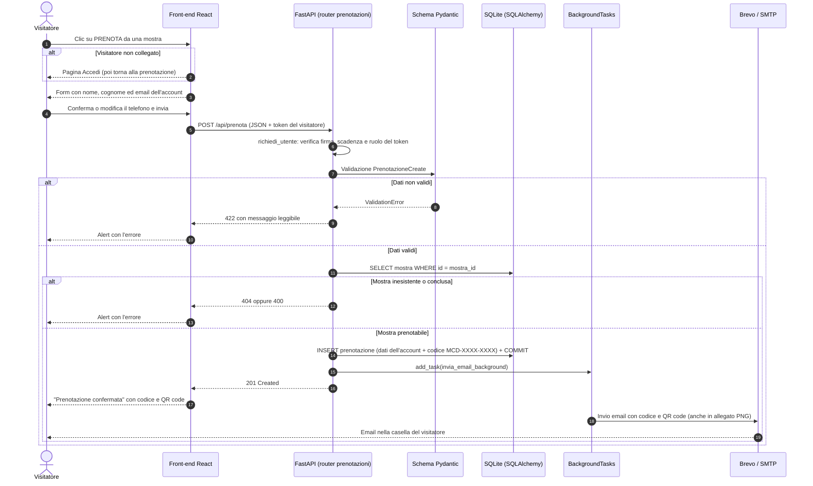
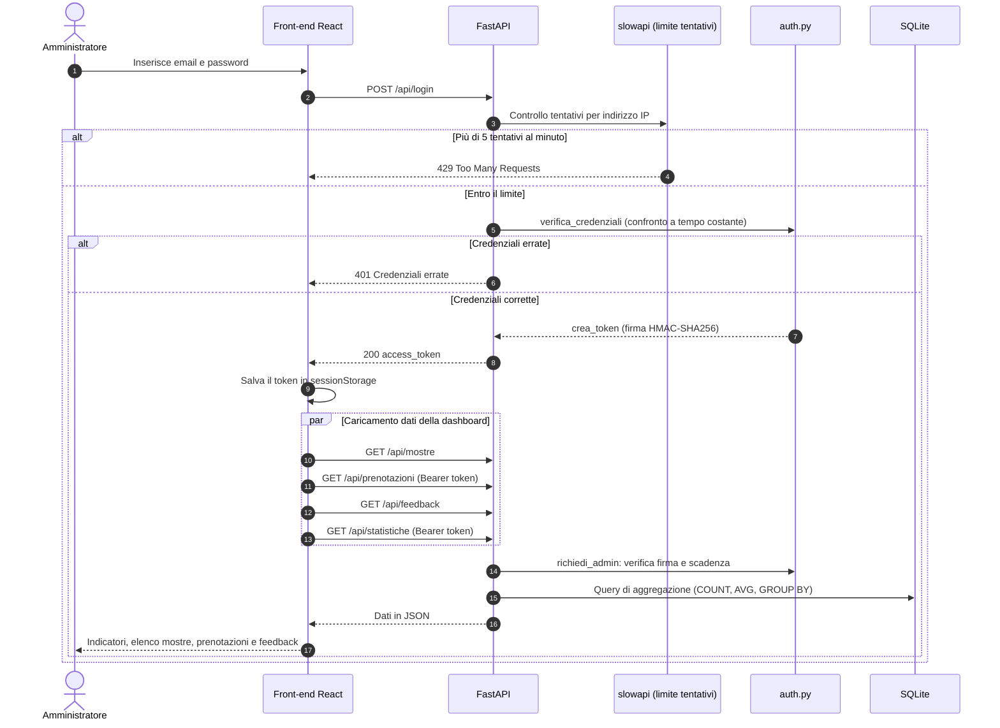
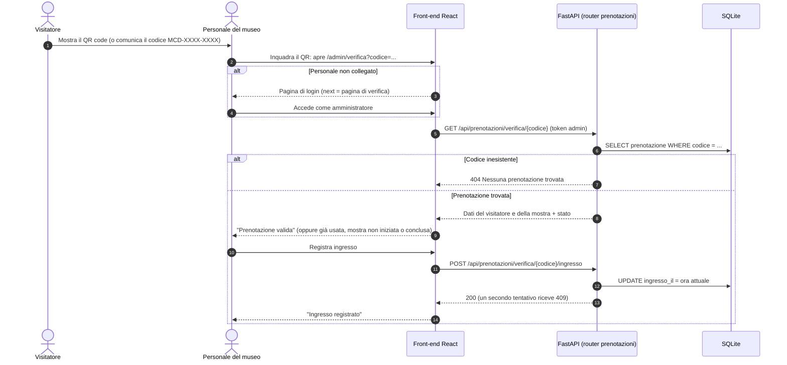

# Architettura

## Architettura generale e deploy

Il sistema è composto da tre livelli (presentazione, logica applicativa, dati) distribuiti su servizi diversi:



1. Il browser scarica da Vercel il front-end, cioè file statici distribuiti tramite una rete di server vicini all'utente (CDN).
2. L'applicazione React, in esecuzione nel browser, chiama le API REST del back-end su Render scambiando dati in formato JSON.
3. Le immagini delle mostre sono servite direttamente dal back-end come file statici.

## Struttura del backend

```
backend/
├── main.py                 → crea l'app, configura CORS, file statici e gestori errori, include i router
├── settings.py             → configurazione letta dalle variabili d'ambiente (.env / .env.local)
├── database.py             → connessione SQLAlchemy e dipendenza get_db()
├── models.py               → modelli ORM (Mostra, Prenotazione, Feedback, Utente)
├── schemas.py              → schemi Pydantic per la validazione di input e output
├── auth.py                 → hash delle password, token con ruolo, controlli di accesso (admin e visitatori)
├── routers/
│   ├── login.py            → POST /api/login (amministratore)
│   ├── utenti.py           → CRUD degli utenti: registrazione, login, profilo, eliminazione dell'account e gestione dall'area riservata (/api/utenti)
│   ├── mostre.py           → CRUD delle mostre (/api/mostre)
│   ├── prenotazioni.py     → POST /api/prenota (una per mostra, con codice), GET /api/prenotazioni, QR code, verifica e ingresso
│   ├── feedback.py         → POST, GET e DELETE /api/feedback
│   ├── statistiche.py      → GET /api/statistiche (indicatori della dashboard)
│   └── contatti.py         → POST /api/contatti (modulo Contatti, invio email al museo)
├── services/
│   ├── mostre_service.py   → ricerca di una mostra e controllo delle date (usato da più router)
│   ├── email_service.py    → email di conferma (API Brevo o SMTP), con QR code in allegato
│   ├── prenotazioni_service.py → codice di prenotazione, QR code (libreria segno) e stato dell'ingresso
│   ├── utenti_service.py   → modifica del profilo ed eliminazione dell'account con anonimizzazione
│   ├── immagini_service.py → validazione e salvataggio delle immagini caricate
│   ├── statistiche_service.py → calcolo degli indicatori per la dashboard
│   ├── rate_limit_service.py → limite ai tentativi di login (slowapi)
│   ├── error_service.py    → formattazione degli errori di validazione (422)
│   ├── migrazioni_service.py → aggiunge al database esistente le colonne introdotte dopo la prima versione
│   └── seed_service.py     → inserimento delle mostre iniziali lette da data/mostre.json
├── data/mostre.json        → dati delle mostre iniziali
├── static/uploads/         → immagini delle mostre
└── tests/                  → test automatici (pytest)
```

I vantaggi di questa organizzazione sono:
- **Leggibilità**: chi cerca le rotte delle mostre apre `routers/mostre.py`, chi deve modificare il testo dell'email apre `services/email_service.py`.
- **Riutilizzo**: i servizi sono funzioni indipendenti dalle rotte; ad esempio `trova_mostra` (in `services/mostre_service.py`) è usata dai router delle mostre, delle prenotazioni e dei feedback, senza che un router dipenda dall'altro.
- **Manutenibilità**: aggiungere una nuova area funzionale significa creare un nuovo router e registrarlo in `main.py` con `app.include_router(...)`, senza toccare il codice esistente. I router `feedback`, `statistiche` e `utenti` sono stati aggiunti proprio in questo modo.
- **Documentazione**: ogni router ha un proprio tag, quindi nella Swagger UI le rotte compaiono raggruppate in *Area riservata*, *Visitatori*, *Mostre*, *Prenotazioni* e *Feedback*.

## Struttura del frontend

```
frontend/src/
├── main.jsx               → punto di ingresso: font e montaggio dell'app
├── App.jsx                → tema, router con le pagine di config/routes.json, header e footer
├── config/routes.json     → elenco delle rotte (percorso, pagina, protezione)
├── pages/                 → una pagina per ogni rotta
├── components/            → header (con IconaMuseo), footer, sezione feedback, indicatori, QrPrenotazione, ProtectedRoute, ErrorBoundary
├── services/              → chiamate HTTP al backend (axios) e gestione dei token
├── hooks/                 → useUtente, useAdmin, useLingua
├── i18n/                  → testi in italiano e inglese, funzioni di traduzione
├── utils/password.js      → regole della password condivise
└── tipi.js                → forma dei dati scambiati con il backend (solo documentazione)
```

In `frontend/public/` ci sono le immagini statiche della home e `favicon.svg`, l'icona del museo mostrata nella scheda del browser.

Le pagine non chiamano mai direttamente le API: usano le funzioni dei moduli `services/*`, che sono gli unici a conoscere gli indirizzi del backend. I dettagli sono nella [documentazione del frontend](../frontend.md).

## Modello dei dati



### Descrizione delle entità
- **mostre**: memorizza le esposizioni culturali (il catalogo). Le immagini sono salvate su disco e nel database se ne conservano i percorsi relativi (es. `/static/uploads/<file>.webp`).
- **prenotazioni**: memorizza le prenotazioni effettuate dai visitatori, con data e ora di creazione.
- **feedback**: memorizza le recensioni dei visitatori, con voto da 1 a 5 e commento facoltativo.
- **utenti**: memorizza gli account dei visitatori. La password non viene mai salvata: si conserva solo il suo hash PBKDF2-SHA256, calcolato con un sale casuale e 200.000 iterazioni. L'email è unica.

**Relazioni**: una mostra ha zero o più prenotazioni e zero o più feedback (relazioni 1:N); ogni prenotazione e ogni feedback appartengono a una sola mostra. Un utente può avere più prenotazioni e più feedback (al massimo uno per mostra). Nella prenotazione nome, cognome ed email vengono copiati dall'account al momento della prenotazione, così lo storico resta leggibile anche se l'account cambia; `utente_id` è facoltativo perché i feedback dimostrativi del seeding non hanno un autore. Eliminando una mostra vengono eliminati anche le prenotazioni e i feedback collegati (cascade), così nel database non restano righe "orfane".

**Vincoli applicativi**: i dati inseriti dagli utenti vengono validati a livello di schema (Pydantic con espressioni regolari e validatori personalizzati) prima di essere salvati. Non è possibile prenotare una mostra già conclusa, né lasciare un feedback su una mostra non ancora iniziata.

**Aggiornamento dei database esistenti**: `create_all` crea le tabelle nuove ma non aggiunge colonne a quelle già presenti. All'avvio `migrazioni_service.py` controlla lo schema e, se manca, aggiunge la colonna `utente_id` alle tabelle `prenotazioni` e `feedback` e le colonne `codice` e `ingresso_il` alla tabella `prenotazioni` con `ALTER TABLE`; alle prenotazioni già presenti assegna un codice e crea l'indice unico sulla colonna. Così un `museo.db` creato con una versione precedente continua a funzionare senza perdere dati.

**Indicatori**: i dati delle tabelle mostre, prenotazioni e feedback alimentano la dashboard. Il servizio `statistiche_service.py` calcola i conteggi con query di aggregazione (`COUNT` e `AVG` raggruppati per mostra con `GROUP BY`), invece di caricare in memoria tutte le righe.

## Sequenza: prenotazione di una visita



## Sequenza: accesso all'area riservata e dashboard


## Sequenza: verifica della prenotazione all'ingresso


