# Funzionalità

## Visitatori

### Catalogo e dettaglio delle mostre

La pagina **Esposizioni** mostra tutte le mostre; ogni scheda porta al dettaglio con descrizione, periodo e galleria di immagini. Il catalogo è pubblico, non serve un account.

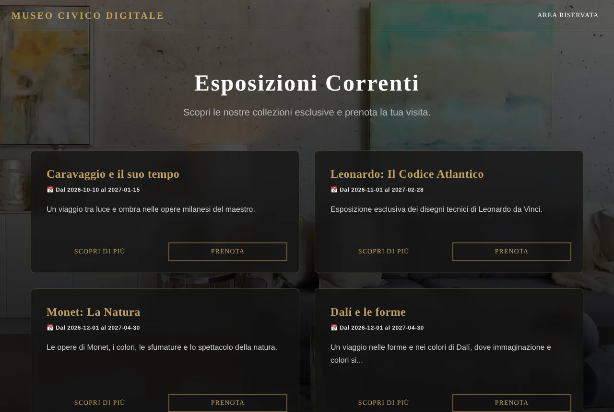{ .screenshot loading=lazy }

### Account

Per prenotare e lasciare un feedback serve un account. La registrazione controlla i dati mentre si scrive (email, telefono, requisiti della password) e invia un'email di benvenuto. Ogni email può essere registrata una sola volta: un secondo tentativo mostra un errore e avvisa per email il titolare dell'account.

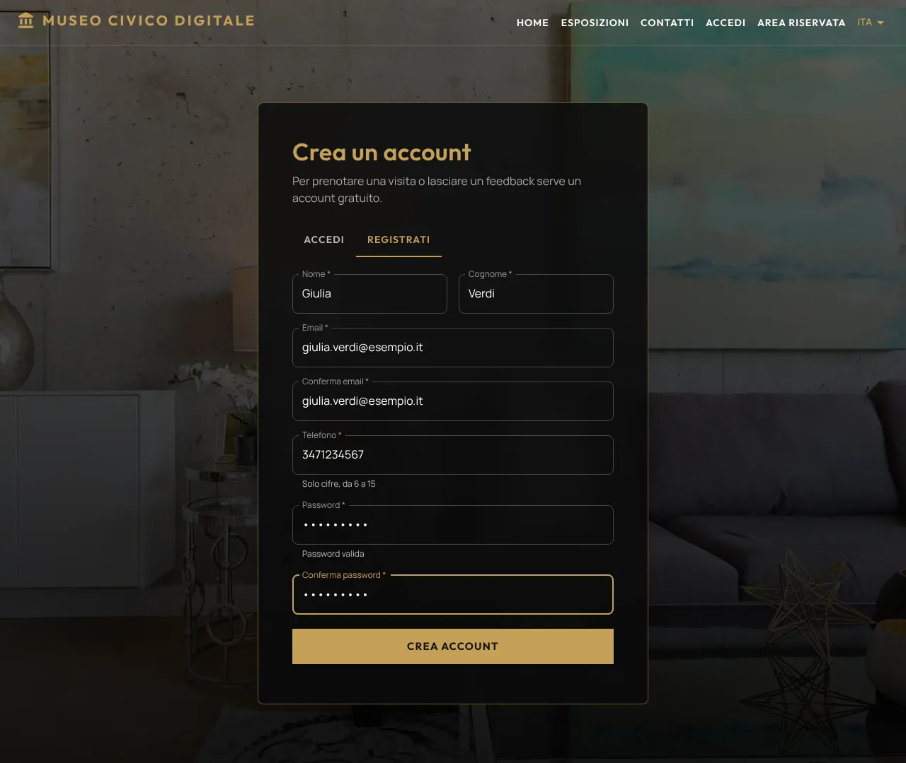{ .screenshot loading=lazy }

Chi dimentica la password riceve un link valido 30 minuti e utilizzabile una sola volta.

### Prenotazione

Il pulsante **PRENOTA** apre il form con nome, cognome ed email dell'account (non modificabili) e il telefono. Dopo la conferma parte l'email di riepilogo. Ogni visitatore può prenotarsi una sola volta a ciascuna mostra: dopo la prenotazione il pulsante diventa **MOSTRA PRENOTATA**.

Ogni prenotazione riceve un **codice di riferimento** (es. `MCD-68ZY-MT8U`) e un **QR code**, mostrati subito nella pagina di conferma e inviati nell'email: il QR code è sempre in allegato PNG e, con il backend online, anche come immagine nel testo.

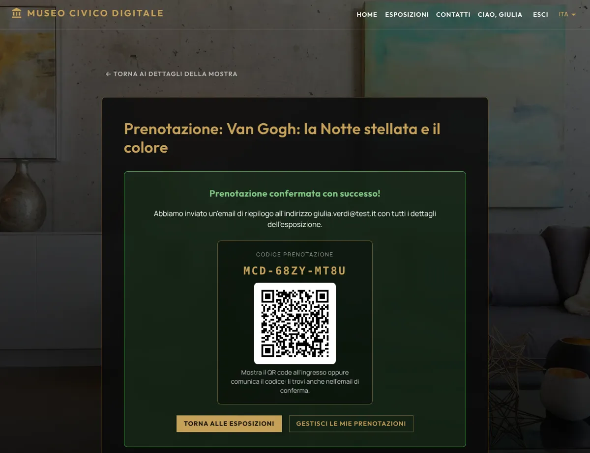{ .screenshot loading=lazy }

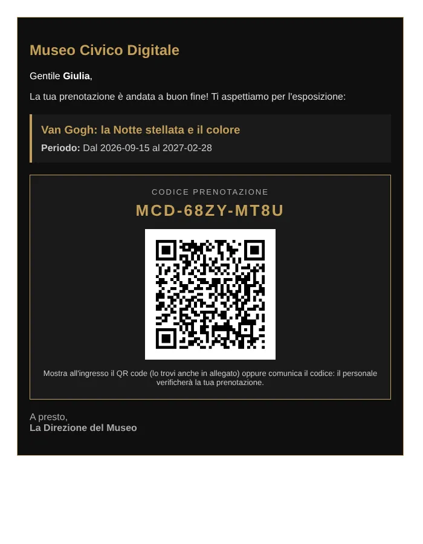{ .screenshot loading=lazy }

### Area personale

Elenca le prenotazioni del visitatore con il loro codice e permette di annullarle; l'annullamento invia un'email di conferma e consente di prenotare di nuovo. Con **Mostra QR code** il visitatore apre il QR code da mostrare all'ingresso. Una prenotazione già usata per entrare non si può più annullare.

Con **Modifica dati** il visitatore corregge nome, cognome e telefono (l'email identifica l'account e non cambia); con **Elimina account**, confermando la password, cancella il proprio account: le prenotazioni non ancora usate vengono annullate, quelle già usate restano nello storico del museo in forma anonima. Al termine arriva un'email di conferma dell'eliminazione, inviata anche quando l'account viene eliminato dal personale.

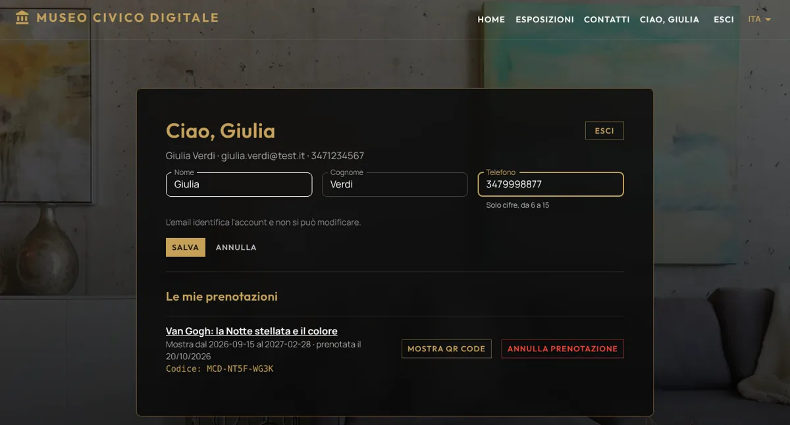{ .screenshot loading=lazy }

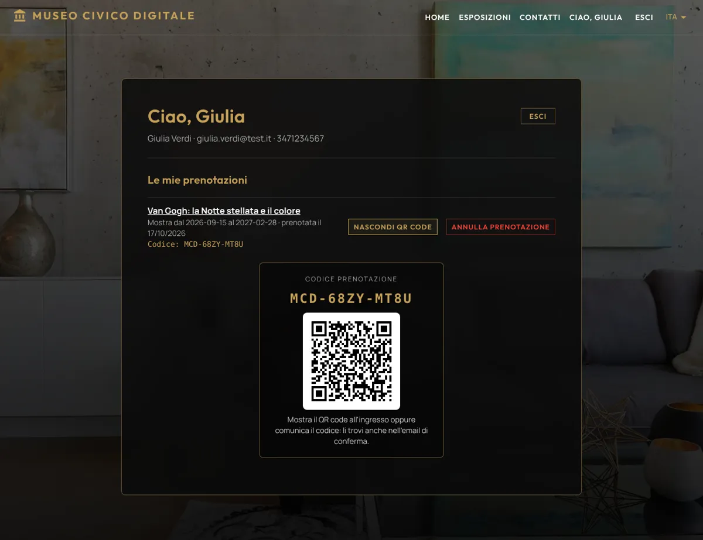{ .screenshot loading=lazy }

### Feedback

Sulla pagina di una mostra già iniziata, chi si è prenotato può lasciare **un solo feedback** (voto da 1 a 5 e commento facoltativo). Il nome pubblico è abbreviato (es. *Mario R.*).

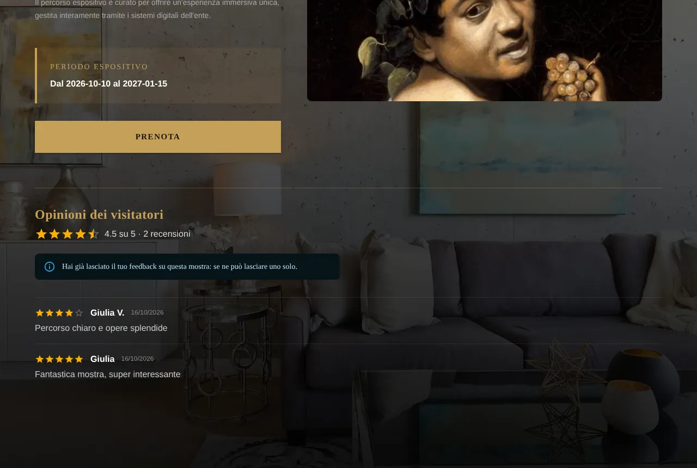{ .screenshot loading=lazy }

### Contatti e lingua

Il modulo **Contatti** (solo per utenti registrati) invia la domanda per email alla casella del museo. Dal menu in alto si sceglie la lingua dell'interfaccia: italiano o inglese.

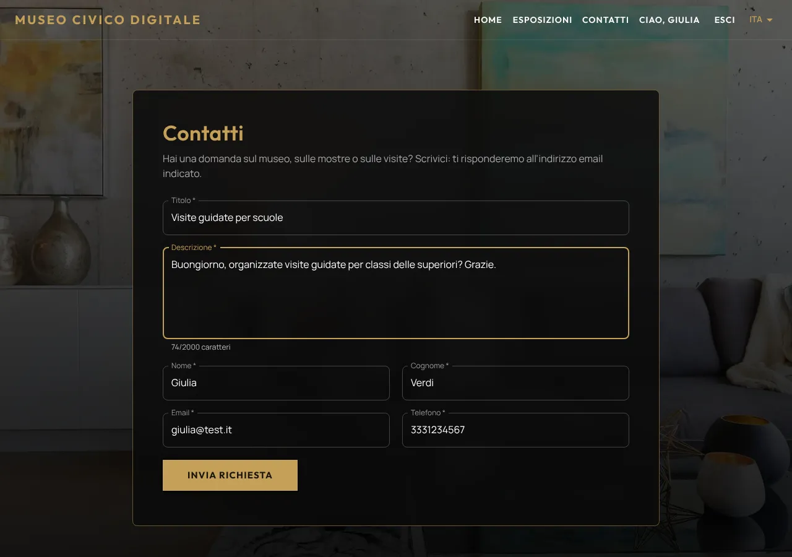{ .screenshot loading=lazy }

## Amministratore

L'**Area Riservata** è accessibile con le credenziali dell'amministratore e solo quando nessun visitatore è collegato. La dashboard mostra gli indicatori principali e, per ogni mostra, le prenotazioni e i feedback; da qui si creano, modificano ed eliminano le mostre e si moderano i commenti.

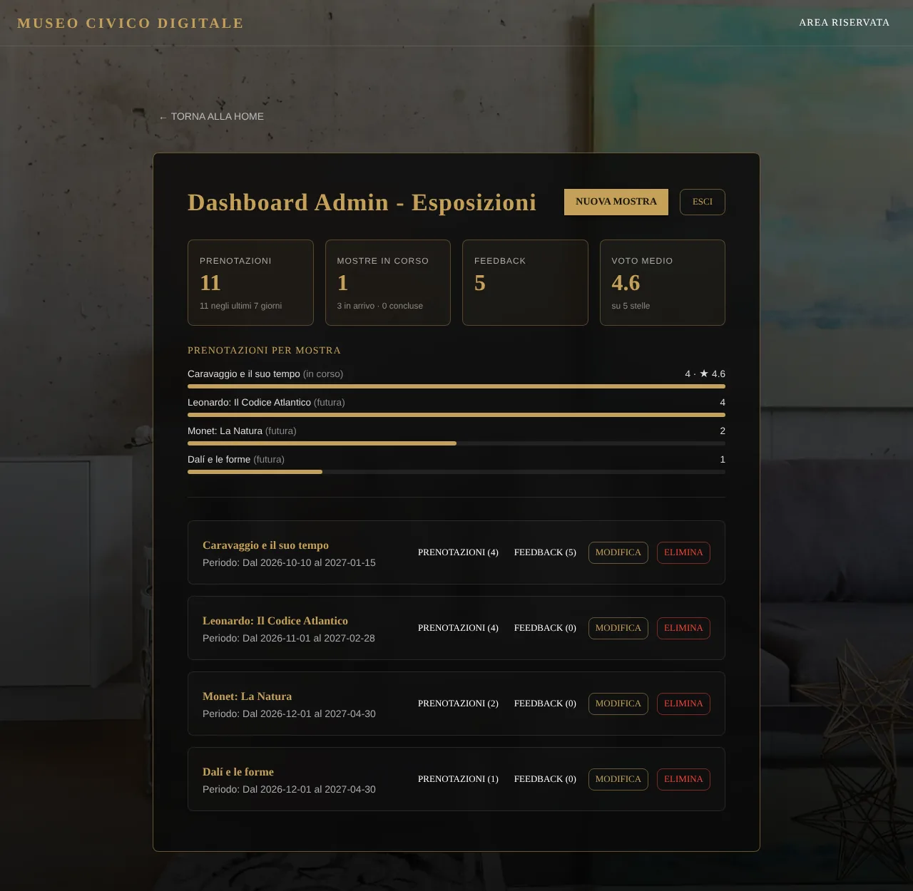{ .screenshot loading=lazy }

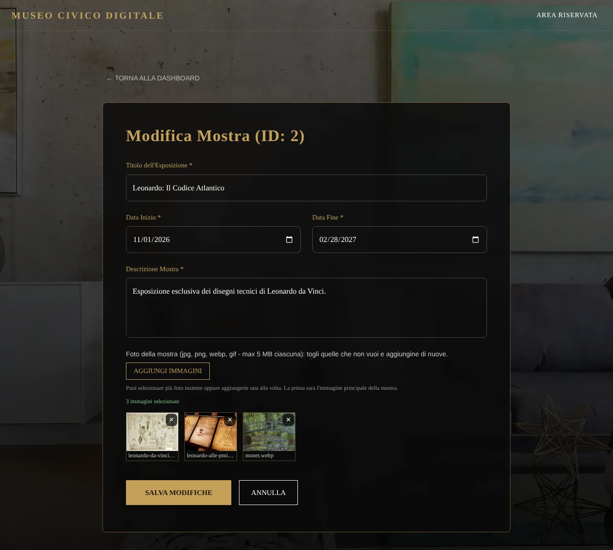{ .screenshot loading=lazy }

### Gestione utenti

Con **Gestione utenti** l'amministratore consulta gli account registrati (ricerca per nome, cognome o email, numero di prenotazioni e di feedback), ne corregge i dati e può eliminarli con le stesse regole dell'eliminazione dal profilo. Insieme alla registrazione, queste funzioni completano il CRUD degli utenti.

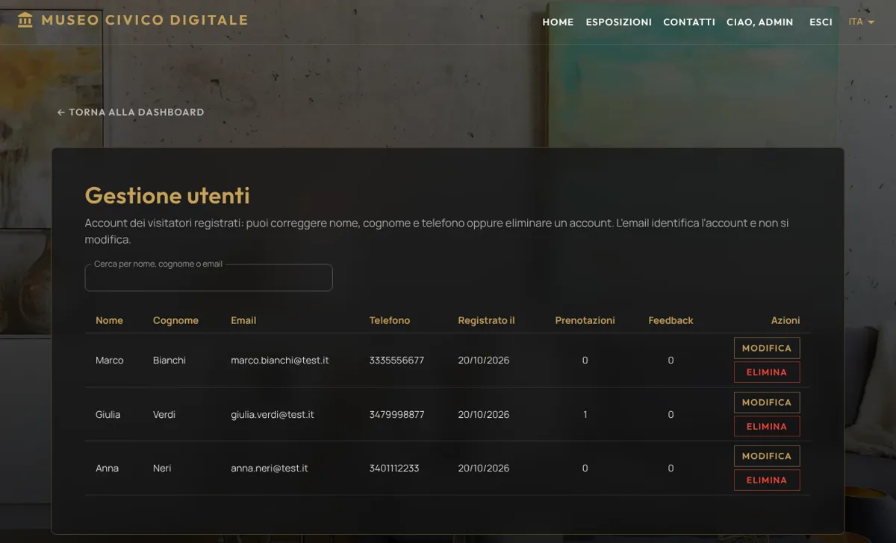{ .screenshot loading=lazy }

### Persistenza dei dati

Account, prenotazioni, feedback, mostre e immagini caricate sono salvati in un database PostgreSQL gestito su Neon, esterno al server: restano anche quando il backend su Render si riavvia o va in pausa. Nei casi d'uso, registrazione, prenotazione, gestione delle mostre e gestione degli utenti includono il caso *Conservare dati e immagini in modo persistente*, svolto dall'attore esterno "Database PostgreSQL (Neon)".

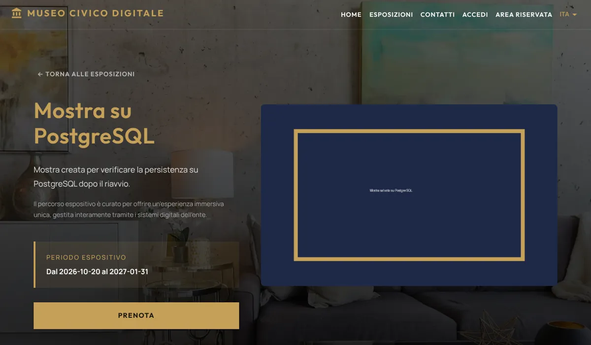{ .screenshot loading=lazy }

### Verifica all'ingresso

Dalla dashboard, con **Verifica ingresso**, il personale inserisce il codice comunicato dal visitatore (anche in minuscolo o senza trattini) oppure il numero della prenotazione. In alternativa basta inquadrare con la fotocamera del telefono il QR code del visitatore: si apre direttamente la pagina di verifica con il codice già inserito (se serve, prima viene chiesto il login). La pagina indica se la prenotazione è valida per oggi, già usata, per una mostra non ancora iniziata o conclusa, e con **Registra ingresso** segna l'entrata: ogni prenotazione vale per un solo ingresso.

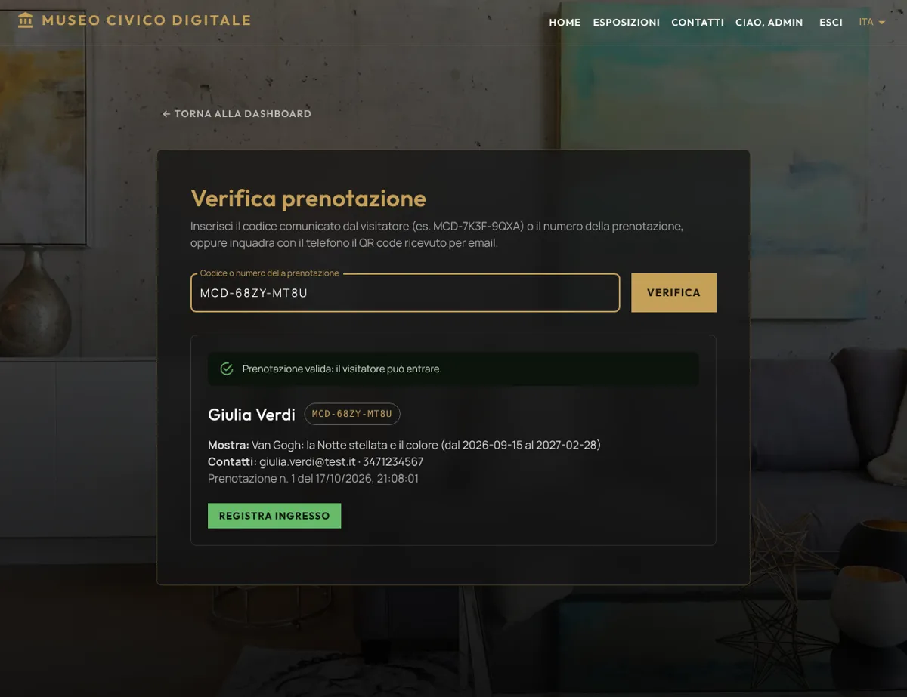{ .screenshot loading=lazy }

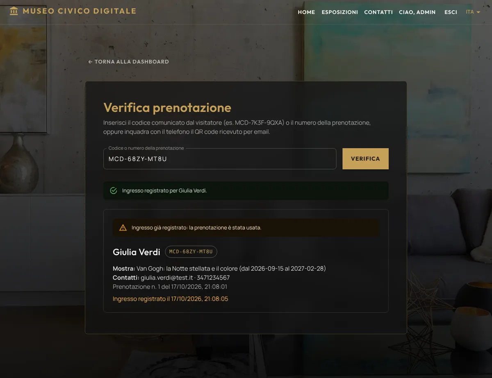{ .screenshot loading=lazy }
